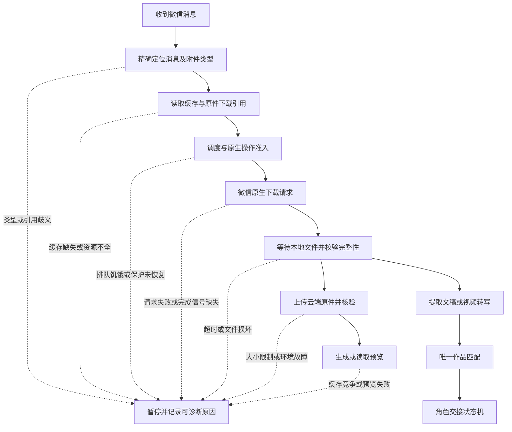
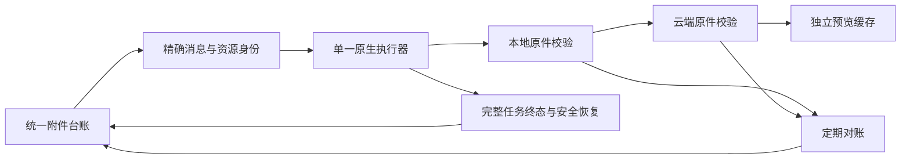

# 微信附件获取与上传下载可靠性复盘

版本：2026 年 11 月 3 日 v01。运行状态快照截至当日 02:19，北京时间。覆盖视频、图片、普通文件及文稿原件；历史数字均带原审计范围，不代表当前剩余故障数。

附件反复出问题，由三类因素叠加：微信原件获取链路的限制、我们自己的调度与恢复设计不完整，以及实际发生的本地和 ECS 环境故障。现有证据不支持把问题笼统归因于 Node、Python 或 PostgreSQL，也不支持认为迁移数据库就能解决微信下载问题。

最需要改进的是完整文件的验收和故障闭环。消息同步成功、预览可用、本地原件完整、云端原件完整是四种不同结果，必须分别记录。

## 上线状态与本次修复

| 项目 | 截至快照时间的结果 | 边界 |
| --- | --- | --- |
| 新交接规则 | `handoff-20261102-v1` 已于 11 月 2 日 14:03 上线，当前工作进程报告该版本 | 规则上线不代表所有附件已匹配，也不构成业务准确率评测 |
| 补充修复 | 11 月 3 日约 02:00 部署异常退出诊断、安全恢复、交接后关闭旧等待记录 | 尚未完成统一附件台账和整个原件归档改造 |
| 原生下载保护 | 图片、视频均无全局阻塞；部署后取得新的图片和视频原件 | 不代表历史失败已全部清零 |
| 数据库与镜像 | 本地 PostgreSQL 可连接，ECS 业务镜像状态正常 | 本地为业务主写，ECS 为通过 HTTPS 快照同步的 PostgreSQL 副本；未迁移 RDS |
| 旧等待记录 | 11 条已成功交接但遗留的等待记录已关闭 | 不重写既有实际任务状态 |
| 修复验收 | Golden 467/467 通过，相关下载、恢复和交接测试通过；Golden 中两项本地媒体检查跳过 | 离线回归不等于真实微信下载、真实转写准确率或长期稳定性验证 |

## 当前附件链路与故障位置

业务状态与附件状态必须独立。视频不超过 150 秒的业务排除，不能显示为下载失败；视频匹配唯一作品后才能推进对应作品的角色交接。微信原生请求已返回，也不能直接标为文件下载成功。

## 微信原件获取链路出现过的问题

| 编号 | 问题及信号 | 已确认事实与原因边界 | 状态或处理方向 |
| --- | --- | --- | --- |
| 1 | 图片只有中图，没有原图 | 10 月 29 日审计中 406 条图片只有中等尺寸资源，原图大小为零且无原图地址；旧逻辑只接受原图 | 原图、中图和缩略图应分级保存。该审计没有验证中图原生下载路线已实施 |
| 2 | 图片下载参数缺失 | 出现 `invalid_image_size_or_server_id`、`original_reference_missing`、`middle_reference_missing`；可见消息不保证缓存里有全部原件参数 | 记录具体缺失字段，不能统一记为网络失败 |
| 3 | 缓存或下载引用准备失败 | `message_cache_unavailable`、`image_reference_prepare_failed`；无法取得精确消息的下载引用 | 发生在下载前；区分历史缓存不可用、可重试读取失败和扫描覆盖缺口 |
| 4 | 原件引用有歧义 | `ambiguous_image_reference`、`ambiguous_video_reference`，存在多个候选 | 停止以防取错文件是正确保护，应加强精确定位而非任选候选 |
| 5 | 附件类型与处理路径不一致 | MP4、PNG 也会以普通文件消息发送，若只看展示名或扩展名，会落入错误解析或限制路径 | 结合消息类型和文件内容判断；视频文件和视频消息均需覆盖 |
| 6 | 任务格式被拒绝 | `image_job_format_rejected` | 属于适配器任务协议或参数校验问题；旧错误码不足以进一步定位具体字段 |
| 7 | 账号与本地适配环境异常 | 出现 `account_verification_failed`；历史检查还记录绑定、版本检查失败及安全软件隔离组件 | 属于本地微信依赖环境；与 ECS 容量故障分开处理 |
| 8 | 原生请求失败 | `native_image_request_failed`、`native_video_request_failed` | 失败结果明确，部分旧回执未保留底层原因；需要完整结构化诊断 |
| 9 | 请求提交后超时 | 原生请求已经返回，但 15 分钟内没有校验通过的文件；历史重试未保留下载完成回调和 CDN 错误 | 超时只是结果。不能由此断定微信风控、网络故障、资源地址过期或组件卸载 |
| 10 | MP4 存在但无有效封装 | 4 个实际视频检测报 `moov atom not found` | 文件损坏、不完整或未正确封装；现有证据无法区分源文件问题和获取过程损坏，不能归因于转写模型 |
| 11 | 图片或表情无法解码 | `invalid_image`、`image_format_unavailable`、表情源不可用或无效 | 区分坏文件、资源缺失和解码能力。历史 5 条图片已可生成缩略图却仍显示旧失败，不能据此宣称原图完整 |

## 自身调度与恢复设计出现过的问题

| 编号 | 问题 | 原因与影响 | 已修复项或剩余工作 |
| --- | --- | --- | --- |
| 12 | 一张图片异常连带阻塞视频 | 最终操作同一微信进程，无法证明安全退出时会触发共享保护 | 保护不能简单删除；应区分单任务失败与进程级不确定风险，并提供安全恢复证明 |
| 13 | 配置替换失败漏记终态 | 暂停配置临时文件生成后，正式配置替换失败；程序处于已完成预检但尚未写入暂停配置的分支空档 | 本次补齐阶段诊断、有限重试、未派发且配置未变时的安全终态；实际旧阻塞经审计解除 |
| 14 | Windows 文件替换竞争 | 状态文件曾出现 `EPERM`、`EBUSY`、`EACCES`，不同脚本存在不同写入路径 | 部分 JSON 路径此前已修；本次补充 PowerShell 配置路径。修复一个路径不代表全部文件写入都已覆盖 |
| 15 | 等待发送任务退出超时 | 图片与视频均出现 `sender_drain_timeout`，未在规定时间内获得安全执行条件 | 明确为准入等待失败，不能伪装成微信原件下载失败 |
| 16 | 视频排队饥饿 | 冷却期延期曾错误消耗调度轮次，导致视频长时间排不到 | 已修相关公平调度；仍需用最老积压时间和分类延迟持续验收 |
| 17 | 文件迟到但失败记录未关闭 | 下载后续完成或文件后来可读，旧失败缓存仍保留；此前迟到文件复查不足 | 已增加迟到文件复查，仍应持续核验原件并与状态对账 |
| 18 | 旧请求无人收尾 | 达到重试上限或离开自动扫描范围后，部分旧任务长期停在 requested 或等待 | 明确终态、下一次复查条件、人工补采入口；避免永久等待 |

### 最近异常退出的具体根因

11 月 2 日 18:41:41，图片下载包装脚本在约 1.1 秒后以退出码 1 结束。现场有新生成的暂停配置临时文件，正式发送配置仍与备份一致，回执停在 prepared，且没有原生下载派发标记。这把故障定位在“替换正式配置”阶段，而非微信已经开始下载后的失败。

代码先设置预检完成，成功替换配置后才设置暂停已写入。替换失败落在两个标记之间，原有异常处理没有为这一分支生成可安全恢复的终态。同时历史日志过滤丢失了实际异常，只剩退出码。因此，可以确认失败阶段和异常处理缺口，不能确认当时 Windows 的具体报错一定是文件占用。

修复后按 preflight、pause_write、pause_replace、drain、dispatch 记录阶段；替换前校验当前配置仍与备份一致，最多重试 5 次，间隔 100 毫秒。诊断保存异常类型、HRESULT、代码位置、任务身份及是否已派发等字段，不保存配置内容和凭据。仅在未派发、配置未改变且清理安全时允许自动恢复；存在派发可能或配置变化时仍保留保护。

### 交接后旧等待记录的独立问题

未匹配到作品时，系统写入没有 task_id 的等待事件；后来匹配成功，会生成带 task_id 的交接事件。旧实现没有同步关闭前一条等待记录，因此已经推进的任务仍被显示为等待。修复对已完成交接进行幂等检查并关闭对应旧等待，实际关闭 11 条；这属于事件生命周期问题，不是微信下载错误。

## 云端与运行环境出现过的问题

| 编号 | 问题 | 已确认事实 | 状态与边界 |
| --- | --- | --- | --- |
| 19 | ECS 磁盘满 | PostgreSQL 写入 `postmaster.pid` 报 `No space left on device` | 已清理并恢复；是明确的环境故障 |
| 20 | 空间释放后服务仍失败 | 空间恢复时 PostgreSQL 仍处于失败状态 | 已恢复服务；需要从磁盘恢复一直验收到数据库和同步服务恢复 |
| 21 | 本地主库停止 | 本地 PostgreSQL 也曾不可用，进程消失的完整原因未留存 | 已恢复；不能直接归因于 ECS 磁盘满，因为是不同实例 |
| 22 | 附件大小限制不统一 | 早期路径有 20 MiB 限制；普通附件路径后来以 400 MiB 阈值拦下两个约 556 和 561 MiB 的 MP4，本地原件存在 | 相关路径已提高到 1 GiB；历史问题是路径限制而非微信没有下载 |
| 23 | 云端预览竞争或生成失败 | 出现 `preview_cache_busy` 和 `preview_failed`；部分历史异常缺少详细诊断 | 预览和原件上传独立验收，不由一个预览错误推断所有原件缺失 |
| 24 | 预览缓存淘汰 | `preview_evicted` | 淘汰缓存可以正常；若没有独立原件归档，就会造成后续无法读取 |
| 25 | 文档预览存在但原件未归档 | 部分文档采用自动提取文字、原件按需获取，存在 previewReady 为真、originalReady 为假的情况 | 尚需统一所有原件保存策略，不能把文字提取成功当成原件上传完成 |
| 26 | 历史消息不在采集范围 | 10 月 29 日审计中 488 条云端缺视频记录在自动原生下载时间范围之外 | 属于历史覆盖缺口，不是当天新增失败；应建立独立补采计划 |
| 27 | 验收把多种成功混在一起 | 元数据同步 HTTP 200、预览可用、本地文件存在，都不能单独证明云端原件完整 | 应以实际对象、大小和哈希核验原件，界面展示各阶段真实状态 |

撤回消息明确排除，不进入补下载和故障重试。历史上 17 条撤回文档被折叠成 document_read_failed，24 条撤回图片仍留在失败或等待状态；这是错误分类和收尾问题，不是需要找回的附件。上述数量是历史审计结果，不是当前未处理数量。

## 技术栈与环境责任判断

| 层次 | 判断 | 改变后的作用 |
| --- | --- | --- |
| Node 与 Python | 没有证据表明语言本身导致这批反复故障；问题集中在跨进程协议、文件替换、状态收尾与错误处理 | 换语言不能自动补齐任务生命周期和文件校验 |
| 微信桌面原生获取 | 依赖账号、进程状态、缓存引用与原生请求，完成回调及错误可观测性不足 | 应减少并发控制入口、保留完成证据，并提供失败后的受控补采方式 |
| Windows 本地运行 | 发生过文件替换冲突、账号校验和组件环境问题 | 统一执行器、配置写入和服务管理比不断增加零散重试更重要 |
| ECS 与 PostgreSQL | 真实发生磁盘满、数据库故障和恢复不完整 | 容量治理、健康检查与服务恢复直接有效；RDS 只能改善其中数据库部分 |
| 附件架构 | 元数据、预览和原件混用成功标志，缓存与归档边界不清 | 统一附件台账和完整原件验收，是跨类型解决问题的核心 |

业务和数据库迁移继续暂缓。本次复盘不代表已经迁移 RDS、改用对象存储或实施下列架构建议。

## 后续改进与验收标准

| 优先级 | 建议改进 | 可验收结果 |
| --- | --- | --- |
| 第一 | 统一附件台账，分别记录发现、请求、原件下载、原件上传、预览状态 | 每条附件可定位当前阶段、证据、错误类型、下一次处理时间；不再用一个 ready 代替所有阶段 |
| 第一 | 单一进程管理微信原生操作，其他模块经队列提交；减少共享配置的多方改写 | 单任务失败不无故拖住全部任务；进程级风险仍会保护；并发和异常退出可离线复现 |
| 第一 | 每次尝试保留开始、阶段、派发事实、终态、退出原因和校验结果 | 不再只剩 exit 1 或 timeout；凭据与私人消息不进入诊断 |
| 第二 | 原件独立持久化，预览可清理；按消息身份、大小及哈希核验本地与云端 | 预览淘汰不影响原件；能准确列出本地完整但云端缺失、元数据存在但原件缺失的附件 |
| 第二 | 新消息优先，历史补采限速；按原因重试，迟到原件自动对账 | 新业务不会被旧重试占满；永久不可用、撤回、暂时失败有不同终态 |
| 第二 | 容量阈值告警、日志治理、数据库与服务恢复检查 | 故障后同时验证空间、服务、数据库查询和同步链路；避免只清理磁盘就宣布恢复 |
| 第三 | 真实附件闭环抽检与持续运行验收 | 分类型统计完整原件成功率、下载上传延迟、最老积压、未知原因比例和恢复时长；按唯一附件去重而非按重试次数统计 |

原件归档至少核对字节数和哈希；视频另做容器可解析检查，图片另做解码检查。源端没有可信校验值时，应明确“本地与云端一致”不等于“已证明与发送端原件一致”。中图和缩略图的可用性不能提高原图成功率。

验证包括离线故障注入、临时数据库回归，以及获授权后的真实附件读取核验；不得为测试向真实联系人发消息或重启微信。通知按事件变化去重，正常监视不向聊天持续发送心跳。

ECS 清理只针对已确认不再使用的旧发布版本和可清理缓存；业务附件、数据库、共享资源、数据备份和 frozen 测试样本不属于旧版本，不能连带删除。

## 证据索引与统计口径

以下为本地审计文件标识，仅用于内部复核；原始私有日志、聊天内容、配置和部署凭据未随本文发布。

| 本地审计位置 | 支持的结论 |
| --- | --- |
| `outputs/download-failure-audit-20261029/summary.json` | 图片资源规格、撤回误分类、旧回执、历史视频范围、原生完成信息缺失 |
| `outputs/download-audit-20261030/attachment-local-summary.json` | 普通文件附件本地核验、两个大 MP4 的 400 MiB 限制 |
| `outputs/download-audit-20261030/cloud-local-comparison.json` | 历史扫描范围及本地云端比较，不能外推到后续全部附件 |
| `outputs/attachment-limit-1g-20261030/public-verification.json` | 1 GiB 路径发布验证，不代表全量原件上传成功 |
| `outputs/runtime-audit-20261102/recheck.private.json` | ECS 磁盘和数据库故障、预览与原件状态差异；该原始文件不公开 |
| `outputs/native-handoff-fix-20261103/acceptance.json` | 本次异常退出和旧等待修复验收 |
| `outputs/native-handoff-fix-20261103/deployed-golden.log` | 已部署版本 Golden 回归结果及跳过项 |
| `docs/video-state-pilot.md` | 调度、原生下载恢复与业务规则实现说明 |

失败回执可能包含同一附件多次重试，不能把回执数量当作失败附件数。历史故障、当前积压、正常排队、撤回和业务排除分别统计。本复盘列出已有证据能识别的故障类别；对未保存底层异常的历史请求，不补造原因。
