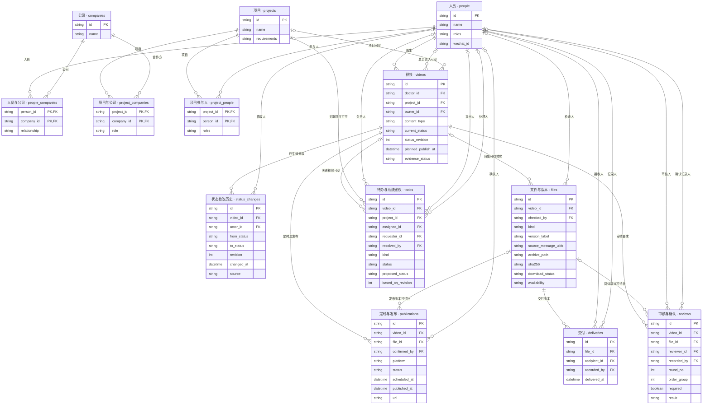
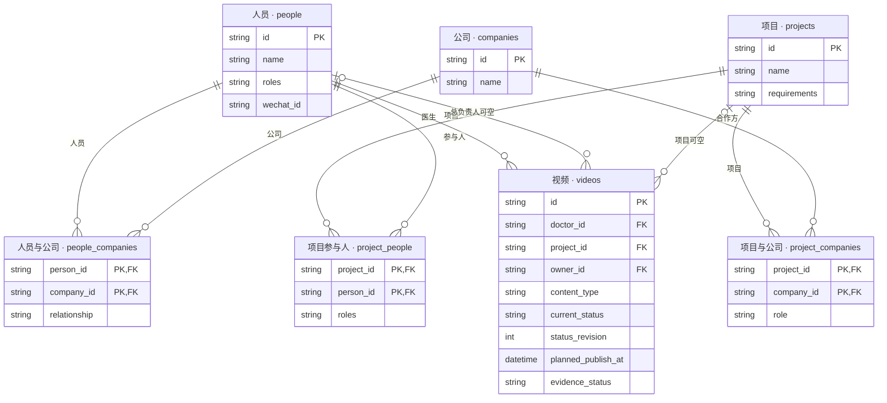
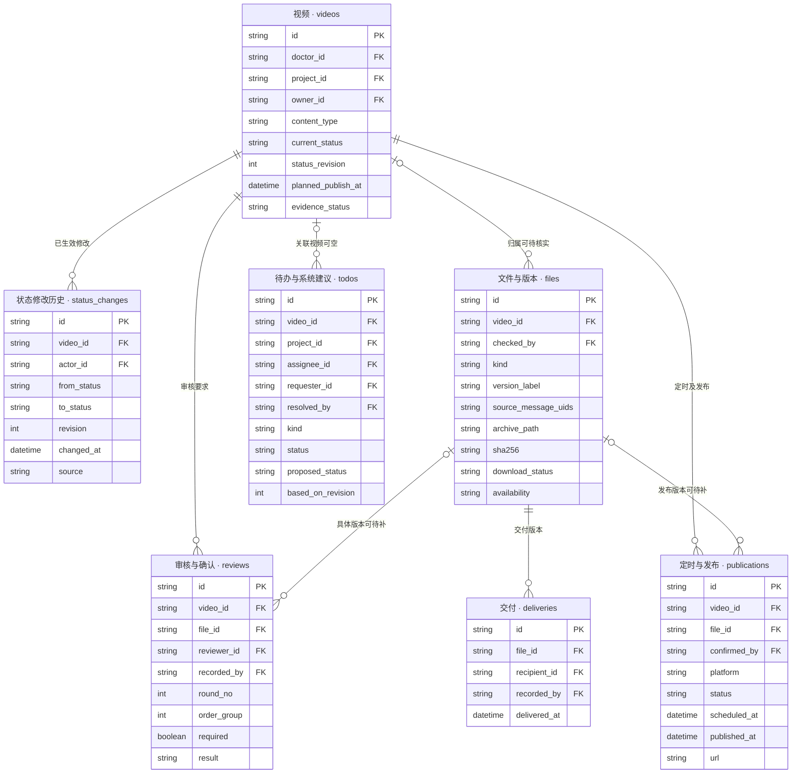
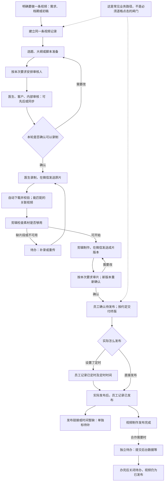
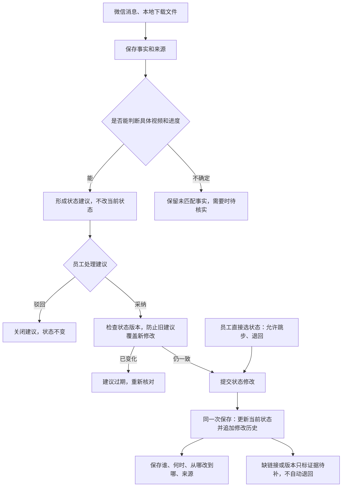
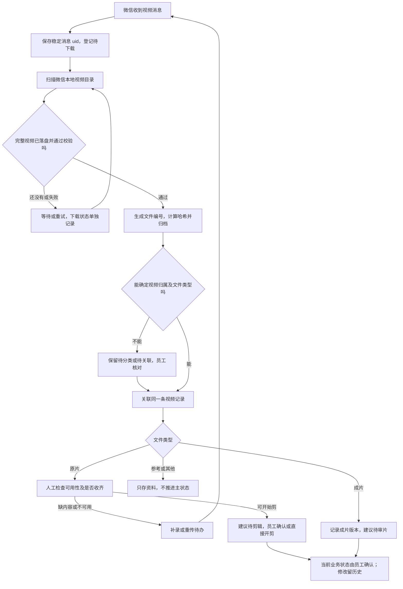

# 麦子工作台：数据结构与业务结构

2026-10-16 v01。设计稿，未实施迁移。人员只用 people；共13张表。员工可直接改状态、跳步与退回，系统建议不覆盖人工确认。微信自动下载替代云盘收片。

[网页与放大图](maizi-business-first-database-20261016-v01.html)

## 完整数据结构 ERD

[SVG 大图](maizi-business-first-database-20261016-v01-erd.svg) · [Mermaid 源文件](maizi-business-first-database-20261016-v01-erd.mmd)

## 人员与合作关系

[SVG 大图](maizi-business-first-database-20261016-v01-relations.svg) · [Mermaid 源文件](maizi-business-first-database-20261016-v01-relations.mmd)

## 视频制作数据结构

[SVG 大图](maizi-business-first-database-20261016-v01-production.svg) · [Mermaid 源文件](maizi-business-first-database-20261016-v01-production.mmd)

## 业务主线

[SVG 大图](maizi-business-first-database-20261016-v01-flow.svg) · [Mermaid 源文件](maizi-business-first-database-20261016-v01-flow.mmd)

## 人工状态与自动建议

[SVG 大图](maizi-business-first-database-20261016-v01-control.svg) · [Mermaid 源文件](maizi-business-first-database-20261016-v01-control.mmd)

## 微信收片与下载

[SVG 大图](maizi-business-first-database-20261016-v01-intake.svg) · [Mermaid 源文件](maizi-business-first-database-20261016-v01-intake.mmd)

## 表的用途

| 表 | 一行代表什么 |
|---|---|
| `people`（人员） | 一个人 |
| `companies`（公司） | 一家公司 |
| `projects`（项目） | 一个合作项目 |
| `people_companies`（人员与公司） | 一个人与一家公司的关系 |
| `project_companies`（项目与公司） | 一个项目与一家公司的关系 |
| `project_people`（项目参与人） | 一个人在这个项目里的分工 |
| `videos`（视频） | 一条明确安排制作的视频，可以还没有初稿 |
| `status_changes`（状态修改历史） | 一次已经生效的状态修改 |
| `files`（文件与版本） | 一份通过微信收到的文件或具体版本 |
| `reviews`（审核与确认） | 一个具体审核对象的一项确认要求及结果 |
| `deliveries`（交付） | 把某版成片交给一个接收人 |
| `publications`（定时与发布） | 一条视频在某平台的一次发布安排或实际发布 |
| `todos`（待办与系统建议） | 一件待处理的事情，或一条尚未采纳的状态建议 |

## 关键规则

- 业务流程不是强制打卡顺序；人工推进可跳步和退回，每次生效修改追加历史。
- 收到消息、下载完整、素材够用、审核通过、实际发布是不同事实。
- 已定时与已发布分开，缺链接或文件只标证据待补。
- 文件无法对应内容时保留未匹配状态，不凭文件名或时间强行关联。
- 审核可先后或同步，新版本保留独立确认；历史缺版本不否认人工已确认进度。
- 发布后数据回收属于独立待办，按合作要求启用。
- 当前处理配置只覆盖一个群；本次发布文档未扩大范围或改变采集服务。