# 各项目实际部署架构与技术选型取舍

版本：2026 年 11 月 3 日 v01。现场只读核查时间约 02:45 至 02:50，北京时间。范围为同一 ECS 上发现的科普麦子、文案工作台、培训工作台、血压系统和血压审核展示站，以及它们依赖的 Windows 本地程序。另列本地文案实验流水线，避免与线上文案工作台混淆；不把 F 盘所有无关目录都算作已部署项目。

**没有把所有本地前后端一股脑搬到 Workbench。** Workbench 是连接和管理 ECS 的工具，真正承载服务的是 ECS 操作系统、Nginx 和后台进程。关闭管理连接不等于停止 systemd 服务。[阿里云 Workbench 官方说明](https://www.alibabacloud.com/help/en/ecs/user-guide/workbench-overview/)

目前是一套混合部署：科普麦子的关键采集与业务处理仍在 Windows；几个网页及其后台在同一台 ECS；培训计算已迁到云端，但输入仍依赖本地微信采集；文案网站已在云端，生成执行器的实际位置尚未查明；血压线上实现与本地旧 README 所写的 Cloudflare 方案不同。

本文中的“tech skill”指技术栈、组件和工程机制，不等于 Codex 的 SKILL.md。每个链路步骤都有技术和职责表；技术目录另列收益、代价、替换条件。实线表示已核查的实现链路，虚线表示未确认的执行主体或尚未实施的建议。

## 项目与运行位置总表

| 项目 | 浏览器前端 | 实际后端与入口 | 主数据位置 | 仍依赖本地什么 | 现场结论 |
| --- | --- | --- | --- | --- | --- |
| 科普麦子 | 原生 HTML/CSS/JS，ECS 提供页面 | ECS Node HTTP 服务；Windows 多个 Node/Python worker | Windows PostgreSQL 业务主库；聊天 SQLite；ECS 聊天 SQLite 与业务 PostgreSQL 副本 | 微信、采集、原生附件、语音/视频处理、角色交接、飞书同步、镜像发送 | 混合部署，业务主处理没有迁到 ECS |
| 文案工作台 | React，Next.js App Router | ECS Next.js standalone；kidney-copy.service | ECS better-sqlite3；另有发布包内文案及选题数据 | 生成 API 等待外部 worker 领取；实际消费者和模型位置未确认 | 网页与业务 API 已云端运行；不能说完整生成流水线均在云端 |
| 培训工作台 | 原生 JS 操作区，静态报告与按需 JSON | ECS Node 操作 API、附件接收器、云端计算 worker | ECS operations.sqlite 与版本化报告快照 | 微信聊天归档同步、Word 原件上传 | 计算已迁云；数据源不是云端直接登录微信 |
| 血压系统 | Nginx 静态 H5、患者端与管理端 JS | ECS Node/tsx HTTP 桥接，复用 Worker 风格路由 | ECS better-sqlite3，D1 兼容接口 | 本地开发与发布，不是运行时微信依赖 | 实际不是 Cloudflare 托管运行 |
| 血压审核展示站 | 独立静态 HTML 与 assets | Nginx 静态站点 | 发布包文件 | 内容制作与发布 | 本站路由未发现独立业务 API |
| 本地文案实验流水线 | 本地 studio 页面/CLI | Python 编排、模型 SDK、Pydantic | 本地提示词、中间结果与 final.md | Windows 文件、模型 API | 本地源码存在，未证明连接线上文案生成队列 |

“前端在 ECS”准确地说是前端文件由 ECS 提供，交互 JavaScript 仍在使用者浏览器执行。不能把浏览器代码、服务端 API、后台计算和数据库当作同一个部署单元。

## 全局架构

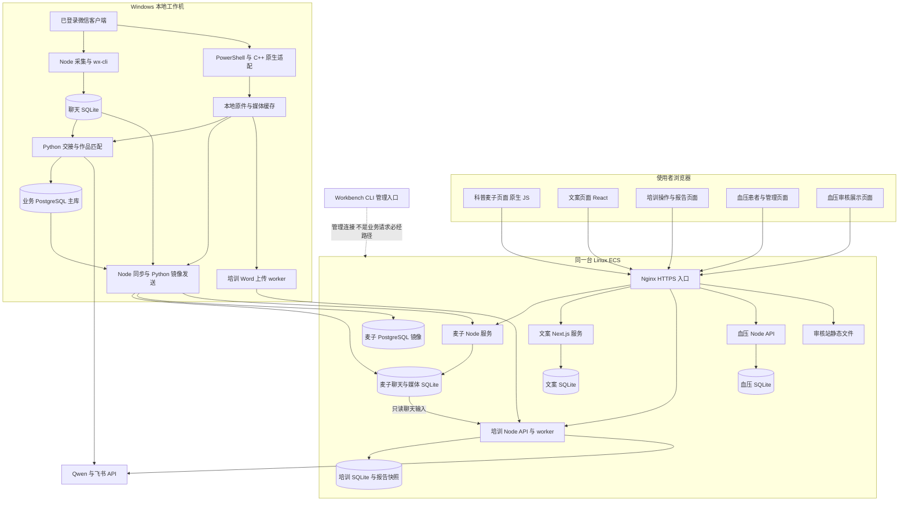

各项目虽然目录和服务用户独立，仍共享同一主机的磁盘、CPU、内存、网络和 Nginx。目录隔离不等于故障域隔离；此前磁盘满会影响数据库及多个服务，正是这个结构的风险。

## ECS 服务与部署控制面

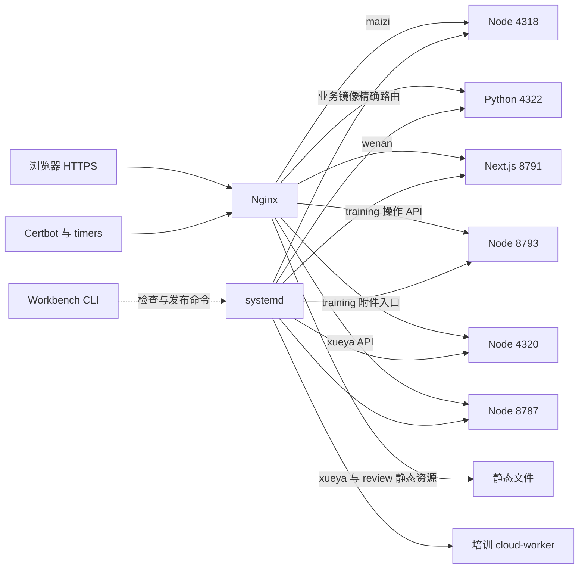

| 单元 | 实际执行技术 | 部署位置或服务 | 核查结果 |
| --- | --- | --- | --- |
| 麦子页面/API | Node v24.12.0，server.mjs | maizi-viewer.service，/opt/maizi-viewer/current | active/running |
| 业务镜像接收 | 独立 Python 虚拟环境 | maizi-business-mirror.service | active/running |
| 文案页面/API | 系统 Node v20.20.2，Next standalone server.js | kidney-copy.service，/opt/kidney-copy/current | active/running |
| 培训操作 API | 专用 Node v24.19.0 | training-operations.service | active/running |
| 培训附件接收 | 专用 Node v24.19.0 | training-attachment-ingest.service | active/running |
| 培训后台计算 | Node 调 Python 与飞书读取 | training-cloud-worker.service | active/running |
| 血压 API | 系统 Node v20.20.2 加 tsx | hypertension-api.service，/opt/hypertension/worker | active/running |
| PostgreSQL | 自建 PostgreSQL 18 服务 | postgresql-18.service | active/running；不是 RDS |
| 公共入口 | Nginx | nginx.service | active/running |
| 系统 Python | Python 3.6.8 | /usr/bin/python3 | 现场命令确认；各业务不应假设同名 python3 就是所需环境 |
| 麦子维护任务 | Python 定时维护 | maizi-viewer-maintenance.service | 最近一次 failed；与网页服务运行状态分开，未在本次完成原因复核 |

这些端口描述 ECS 内部路由，不是建议开放到公网。业务浏览器统一通过 HTTPS；公开文档不包含服务器 IP、实例 ID、凭据和私人聊天。

同一天还可见历史一次性发布任务的 failed 记录。它们不能直接代表当前线上版本失败；判断发布结果应核对 current 指向、运行进程、健康检查和发布回执。

## 科普麦子消息采集与查询

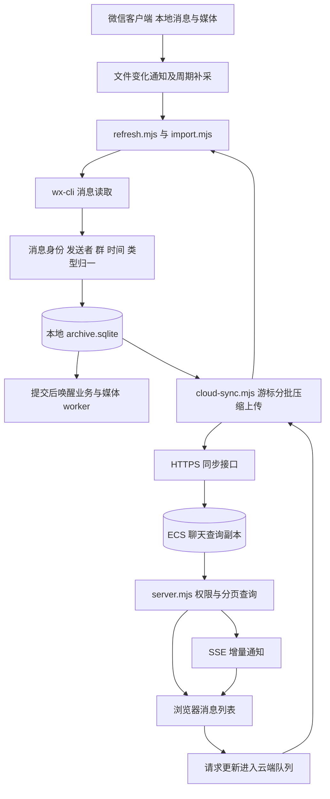

| 步骤 | 输入到输出 | 技术与主要代码 | 责任与边界 |
| --- | --- | --- | --- |
| M01 | 微信数据变化到采集触发 | Node，refresh.mjs | 触发不等于已经完整归档，仍需事务和游标 |
| M02 | 精确消息到规范记录 | wx-cli，import.mjs，Python 辅助读取 | 依赖已登录客户端与本地可用缓存；不是网页微信 |
| M03 | 规范消息到归档 | SQLite、稳定消息身份、索引/全文检索 | 保存来源证据，不把聊天库当业务主库 |
| M04 | 已提交消息到 worker 唤醒 | 文件/状态通知和轮询补偿 | 通知丢失时靠持久游标补读，不能只依赖一次内存事件 |
| M05 | 本地归档到云端副本 | Node HTTPS、压缩、分批、确认游标 | 本地离线仍可查云端历史，但不会凭空补出新消息 |
| M06 | 云端查询到界面 | Node HTTP、原生 JS、SSE | 登录、分页、过滤、增量刷新；不在浏览器直连数据库 |
| M07 | 网页请求更新到本地采集 | 云队列与本地领取 | 本地不需开放公网入站端口；网页不能任意执行本机命令 |

## 科普麦子附件的两条完成线

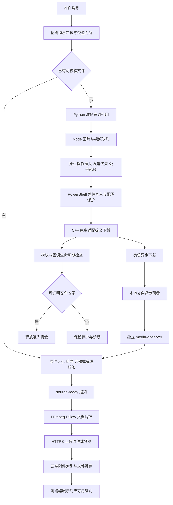

原生调用返回、DLL 安全收尾、文件完整落盘、云端上传完成，是四个不同事件。等文件和转码不应一直占着原生操作锁；但未证明原生操作安全退出时，也不能简单强行解锁。

| 步骤 | 技术与代码入口 | 具体工作 | 重要限制 |
| --- | --- | --- | --- |
| M08 | image/video-download-job.py 等 | 从精确消息准备下载引用，区分普通文件与原生视频消息 | 原件参数缺失、引用歧义不等于网络失败 |
| M09 | media-pipeline-worker.mjs | 图片、视频准备和 native 通道分工，避免排队饥饿 | 任务失败和进程级不确定风险需不同范围的保护 |
| M10 | image/video-download-once.ps1 | 配置暂停、发送排空、原生调用、诊断与恢复 | Windows 文件替换需检查并发修改，不能盲目覆盖 |
| M11 | C++ DLL 原生适配 | 向本地微信提交受控操作 | 客户端版本与进程生命周期耦合；长期稳定不能由普通单测证明 |
| M12 | media-observer-worker.mjs、observe-media.py | 在不占原生锁的情况下核验实际文件 | 接口“请求已返回”不能代替文件完成证据 |
| M13 | ffprobe/FFmpeg、图片解码、Word/PDF 提取 | 时长、容器、可播放性、缩略图、文档文字 | 预览成功不证明原图或文档原件已归档 |
| M14 | source-ready-worker.mjs、HTTPS 同步 | 告知云端可以重新取文件并更新索引 | 云端仍需实际接收和校验，不能只改 ready 标志 |
| M15 | ECS SQLite 索引与文件目录 | 展示附件、处理按需原件与预览缓存 | 当前尚未统一全部原件持久归档；缓存淘汰与原件删除必须分开 |

详细的 27 类故障、最近配置替换异常和恢复证据见[附件可靠性复盘](../attachment-reliability-20261103/maizi-attachment-reliability-review-20261103-v01.md)。

## 视频转写与作品匹配

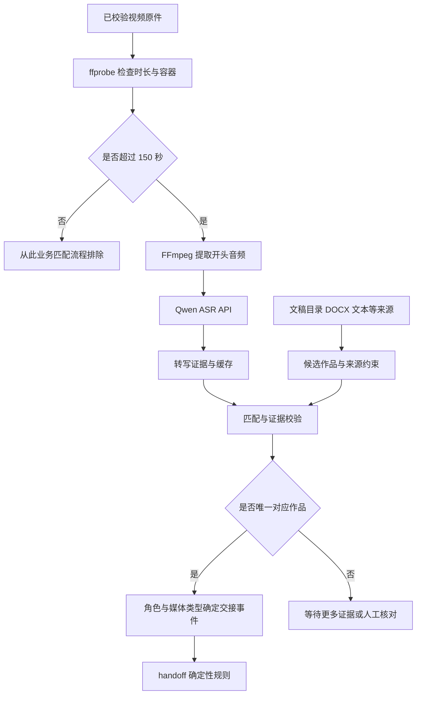

| 步骤 | 技术 | 说明 |
| --- | --- | --- |
| M16 | Python、ffprobe、FFmpeg | 先证明文件可读，再做业务时长排除；排除不表示下载失败 |
| M17 | video-opening worker、qwen-asr.py | 云 API 转写，本机负责音频准备与缓存；当前 ASR 配置模型为 qwen3-asr-flash |
| M18 | manuscript catalog、来源消息与作品目录 | 文稿必须先进入候选目录；未纳入的文稿无法靠改阈值补出来 |
| M19 | 视频目录与匹配逻辑 | 唯一关联后才能推进对应作品；不能把转写文字相似就当确定同一稿件 |
| M20 | handoff_runtime.py | 新交接规则明确不使用语义模型兜底；Qwen 出现在证据处理链，不意味着它决定每次状态变化 |

候选窗口、相似度和兜底策略应以具体运行配置与匹配模块为准。本次不把此前讨论过的“视频前 30 天”直接写成已部署常量，也不据离线样本宣称真实 ASR 准确率。

## 交接状态机与业务事务

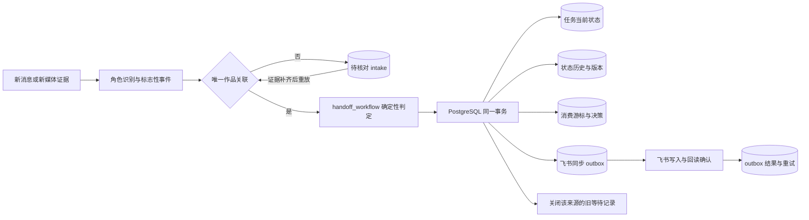

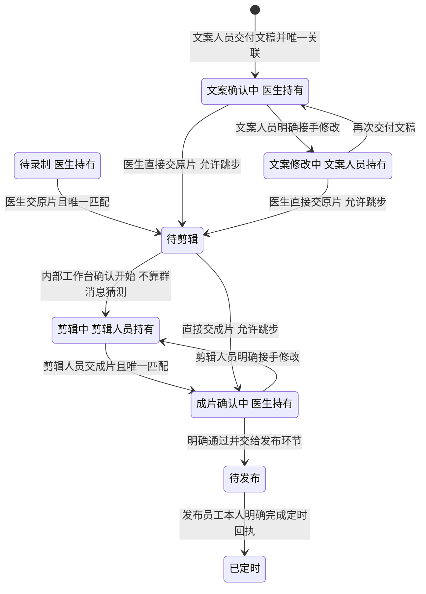

第二张图是主要交接与内部状态的组合视图，不是全量允许边清单。待录制保留在存储契约中，但当前 handoff 代码没有“医生确认文稿后自动进入待录制”的事件，因此图中不画这条自动边。待剪辑到剪辑中标的是内部工作台职责，不是当前聊天探针自动识别边。文稿各阶段也允许直接交成片；已核实发布员工的完成定时回执可从受支持的非终态跳到已定时，不要求先观察到待发布。医生单独提出意见不自动交回员工，交回依据是员工接手事件。发布链接才支持已发布事实，但本版自动交接不推进到已发布。终态、人工例外状态和非科普作品另有保护，具体允许边以 handoff_workflow.py 和冻结样本为准。

| 步骤 | 技术与文件 | 一致性边界 |
| --- | --- | --- |
| M21 | task-state-worker.mjs 唤醒 Python | 状态 worker 常驻本地，不由聊天中的定时提醒驱动 |
| M22 | handoff_runtime.py、handoff_workflow.py | 版本 handoff-20261102-v1；角色交接与标志性事件 |
| M23 | PostgreSQL、事务、状态版本、事件唯一键 | 任务、历史、游标和业务 outbox 一起提交，避免一半成功 |
| M24 | intake resolve 与幂等重放 | 后来关联成功时关闭原无 task_id 的等待；重复处理不能重复改状态 |
| M25 | 飞书适配器与回读 | 飞书同步失败应保留本地业务事实并重试；不能悄悄把外部展示当唯一事实 |

## 网页发送与业务同步是两种队列

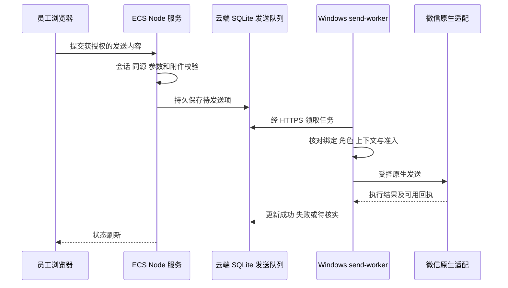

这是已经存在的产品链路说明，本次核查没有向真实联系人发送消息。云端 SQLite 发送队列与 PostgreSQL 中的飞书 outbox 具有不同接收方和权限，不能因为都叫 outbox 就合并成同一消费者。

## 本地业务库与 ECS 镜像

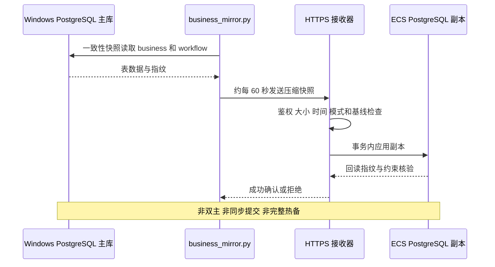

复制表数据不等于复制 PostgreSQL 角色、DDL、序列计数和媒体原件。镜像库不是可不经检查直接切主的热备。不能让 ECS 再启动一套消费者处理复制过去的 outbox，否则可能重复外部写入。用户已经暂缓数据库迁移，本次只做架构核查。

## 培训工作台的云端计算与本地数据源

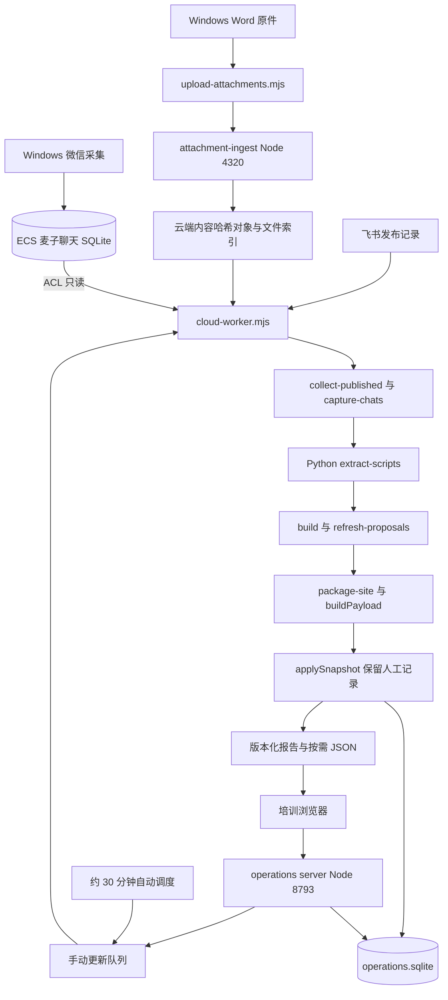

| 步骤 | 具体技术/代码 | 输入输出与边界 |
| --- | --- | --- |
| T01 | upload-attachments.mjs，本地 Node | Word 原件从 Windows 送往云端；现场观察到该本地进程 |
| T02 | attachment-ingest.mjs，HTTPS、内容哈希 | 云端接收、去重、保存对象与原文件名映射，不依赖浏览器上传整个聊天库 |
| T03 | Linux ACL 与 training-chat-read-access.timer | 云端 worker 只读麦子聊天 SQLite；WAL/SHM 重建后需要恢复限定访问权限 |
| T04 | cloud-worker.mjs，持久队列、轮询和进度心跳 | 自动约 30 分钟，手动更新也走同一队列；不启动第二套冲突计算 |
| T05 | collect-published.mjs、飞书接口/CLI | 读取发布事实；不是推断医生视频已经发布 |
| T06 | capture-chats.mjs、extract-scripts.py | 云端读取已同步聊天并解析 Word；无法补出本地未取得的源文件 |
| T07 | build.mjs、refresh-proposals.mjs | 汇总医生、作品、归属与建议；建议不自动覆盖人工决策 |
| T08 | package-site.py、内容哈希 JSON | 页面汇总内联，细节按需加载；共享内容对象必须考虑旧页面引用 |
| T09 | applySnapshot、operations store | 系统快照与人工操作分开保存，更新不覆盖人工沟通记录 |
| T10 | Node 内置 SQLite、版本冲突检测、审计历史 | 员工只操作授权对象，负责人管理特殊决定；避免并发覆盖 |
| T11 | Nginx auth_request、个人会话、CSRF | 报告、附件和操作 API 统一受访问保护；旧 Basic 路径与个人会话并存 |

9 月“静态报告需本地重新发布”的文档是历史版本；10 月 15 日 cloud-active 配置、云端 worker 源码和本次 active 服务证明计算已迁云。上云计算仍依赖麦子消息同步和本地附件入口，不能解读为脱离 Windows。

## 文案工作台的线上实现

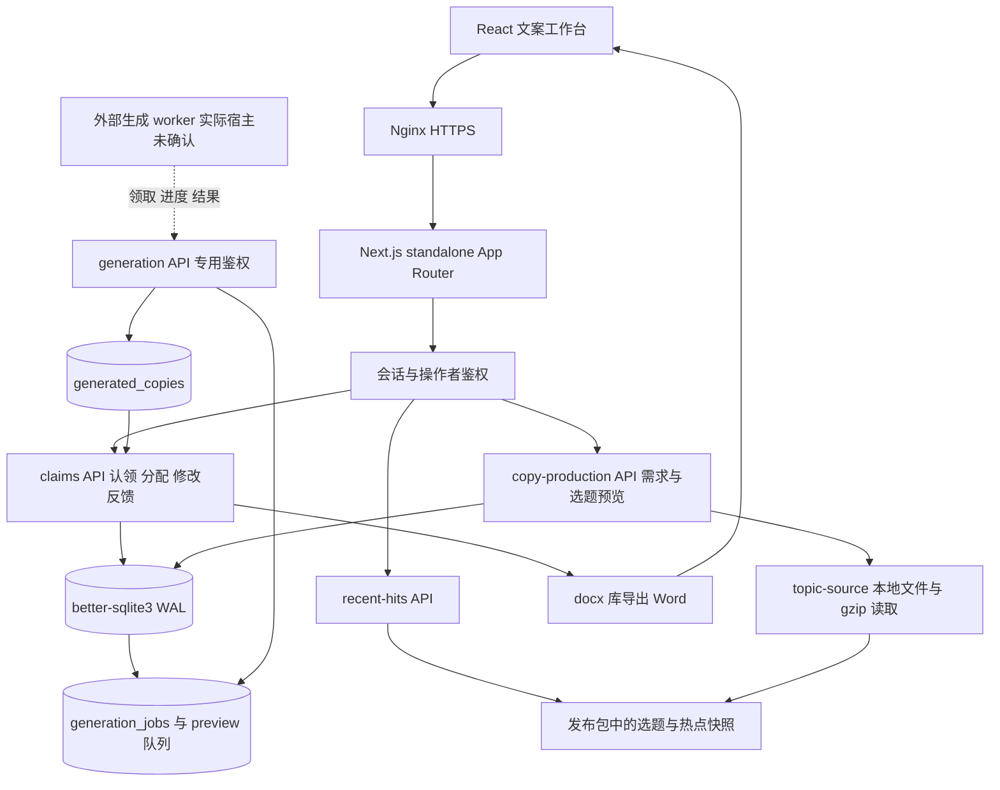

| 步骤 | 技术/模块 | 实际职责 | 不能据此推断什么 |
| --- | --- | --- | --- |
| W01 | React 19、Next.js 16，版本范围来自部署 package.json | 页面、工作区、选题来源详情和制作界面 | 不把依赖声明范围当作完整运行时锁定版本 |
| W02 | Next Route Handlers、同源校验、会话 | /api/auth、/api/claims、/api/copy-production 等 | Next 不意味着必须部署到 Vercel 或 Cloudflare |
| W03 | better-sqlite3 与 lib/node-d1.ts | 本地文件数据库，WAL、外键、busy timeout | D1 接口名称不代表正在使用 Cloudflare D1 |
| W04 | lib/db.ts、lib/workspace.ts | operators、sessions、claims、assignments、workflows、revisions、events、requests 等 | 当前文案数据与麦子 PostgreSQL 不是同一事务库 |
| W05 | lib/copy-production.ts、lib/generation.ts | 请求入队、预览、worker 领取、进度与结果回写 | 发现队列表和接口不等于后台消费者在线 |
| W06 | /api/generation 专用 token 与时序安全比较 | 给获授权生成执行器调用，独立于浏览器普通用户会话 | 本次未触发真实生成，未确认消费者宿主和模型供应商 |
| W07 | topic-source.ts、recent-hits.ts、本地 JSON/gzip 数据 | 读取预先发布的选题与来源快照 | 没有从这些模块发现在线向量数据库检索，不能把所有来源读取都叫向量 RAG |
| W08 | export-docx.ts、docx 库 | 导出文稿文件 | 导出成功不等于微信已发送或医生已确认 |

线上 current 指向 11 月 1 日版本，服务运行入口为 standalone server.js。部署依赖仍含 OpenNext、Wrangler 和 D1 类型，但实际使用的是 ECS 自托管模式。部分生成模块直接取得原生 SQLite 连接，说明平台兼容层并非完全抽象；不能承诺原样切换 Cloudflare 即可运行。

### 本地文案实验流水线与线上队列不能画成已连通

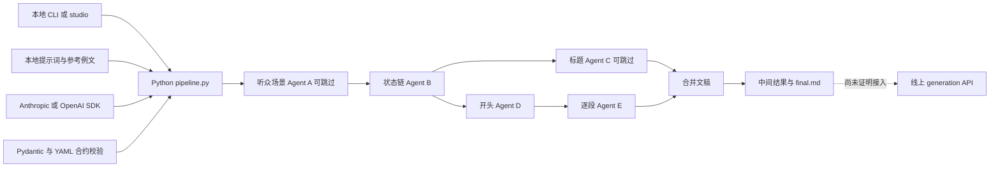

本地 `F:/wenan workflow` 有上述 Python、SDK、Pydantic、PyYAML 代码与说明。它是可检查的独立实验实现，本次没有证据将它认定为线上文案队列的当前消费者。其他本地 wenan 目录也不能仅凭名字合并成一个生产项目。

## 血压项目实际运行链路

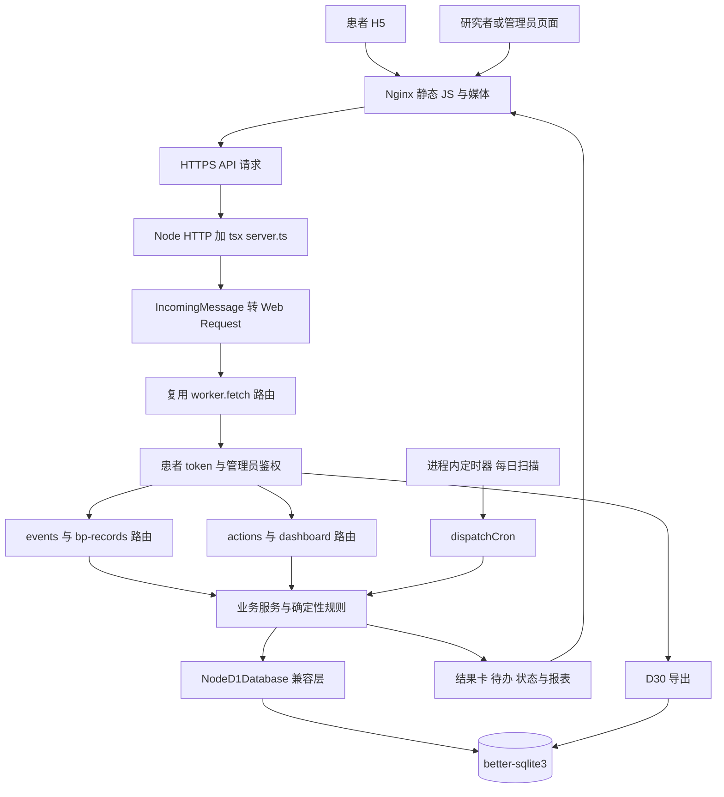

| 步骤 | 技术/代码 | 作用及取舍 |
| --- | --- | --- |
| X01 | 静态 HTML、原生 JS、媒体清单 | 患者交互、结果卡、状态缓存；页面与 API 分开提供 |
| X02 | node/server.ts、node:http、tsx | ECS 运行 TypeScript，并把 Node 请求桥接为 Web Request |
| X03 | src/index.ts 与 routes | 保留 Worker 风格 fetch 路由，复用原有业务代码，不等于 Cloudflare 正在托管 |
| X04 | auth、token、admin-auth、CORS | 患者 token 与后台管理鉴权；允许来源和参数仍需服务端校验 |
| X05 | events、bp-records、actions、dashboard、self-enrollment | 记录事件、测量、行动与运营闭环，服务层负责多表约束 |
| X06 | engine/realtime、medical-rules、medication-rules、weekly、cron | 确定性业务规则和周期任务；本次不评价临床规则正确性，不把系统建议等同临床结论 |
| X07 | node/d1-adapter.ts、better-sqlite3、WAL | 本地 SQLite 模拟 D1 接口；迁移需验证 batch/事务/错误语义是否一致 |
| X08 | node/migrations.ts、SQL migrations | 启动检查数据库结构，不能用重新发布覆盖患者数据库 |
| X09 | setTimeout 与 setInterval | 服务启动时计算下次 08:00 并每 24 小时运行；依赖主机时区和进程存活，未看到此入口的持久补跑调度 |
| X10 | export/d30 与 admin-exports | 输出结构化研究数据；导出权限和审计需要独立验收 |

本地旧 README 的“仅 bootstrap”“路由尚未实现”“Cloudflare D1”描述已不足以说明线上现状。现场部署源码具有完整 routes、engine 和 Node 适配入口；这比单看本地 README 更能代表实际运行结构。未发现实际飞书同步服务的充分证据，不将其画成已上线链路。

## 血压审核展示站

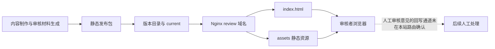

现场 Nginx 仅允许首页、assets 和 robots 等静态路径，其余返回 404；current 目录只有 public 与发布回执类文件。没有证据说明该展示站会直接写血压生产数据库，不能因为同属血压项目就把它画成同一后台。

## 数据归属与跨项目耦合

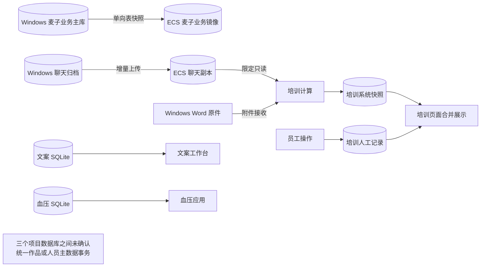

| 数据类别 | 事实归属 | 复制或派生 | 主要风险 |
| --- | --- | --- | --- |
| 微信消息证据 | 本地采集归档 | ECS 查询副本，培训只读输入 | 本地停采，多个云端业务一起失去新证据 |
| 麦子任务状态 | Windows PostgreSQL | ECS 业务镜像、飞书展示 | 重复消费者、镜像误当主库、库可用但游标不前进 |
| 原始媒体 | 当前分散在本地文件与云端部分归档 | 预览、转写、哈希索引 | 预览可见但原件缺失、多个缓存状态不一致 |
| 培训人工操作 | ECS operations.sqlite | 工作区与报告展示 | 自动更新覆盖人工事实、账号或版本冲突处理不一致 |
| 文案需求与结果 | ECS 文案 SQLite | DOCX 导出、静态来源数据 | 生成消费者缺少可定位部署信息，任务可能入队后无人执行 |
| 血压患者数据 | ECS 血压 SQLite | 页面、待办、研究导出 | 同机磁盘故障、定时任务漏跑、平台适配语义差异 |

## 每种技术的收益与替代条件

下表是针对现有规模和故障的工程判断，不表示替代项已经采用。先消除生命周期和验收缺口，再决定是否增加新基础设施。

| 技术或机制 | 当前使用处 | 收益 | 代价和风险 | 可替代方案与建议 |
| --- | --- | --- | --- | --- |
| Windows 微信客户端 | 麦子输入与原生操作 | 取得实际群聊和媒体 | 登录、客户端版本、缓存与进程依赖 | 保留必要采集边缘节点；可增加获授权人工补传入口，不能假设换网页微信就等价 |
| wx-cli 读取 | 消息归档 | 可脚本化、按消息定位 | 本地数据格式与可用性依赖 | 用统一只读适配契约封装，先增强错误分类，不因换语言重写所有读取 |
| C++ 原生适配 | 微信下载与发送 | 能执行客户端原生能力 | 版本耦合、生命周期风险、真实完成可观测性弱 | 单一原生执行器加结构化回执；稳定性收益比增加更多注入入口高 |
| PowerShell 包装 | 本地进程与准入 | Windows 原生管理方便 | 多脚本共享配置、退出路径和文件锁易分散 | 收敛控制入口，文件状态写入统一；保留脚本作安装与诊断工具 |
| Node worker | 同步、下载调度、服务 | I/O 协作自然、共享 JS 类型与模块 | 多进程身份、锁、生命周期需自行设计 | 先统一任务台账与监督，再评估独立队列服务 |
| Python worker | 媒体、文稿、状态、镜像 | 处理库成熟，规则易回归 | 解释器、虚拟环境和依赖漂移 | 每个服务固定解释器与依赖锁；不是全面换成 Node |
| 系统多版本运行时 | ECS Node 20/24、Python 3.6/独立 venv | 不打断旧应用，可独立演进 | PATH 与部署假设不一致 | 版本清单、显式路径、CI 构建；以后按服务标准化镜像 |
| 原生 JS 页面 | 麦子、培训、血压 | 构建简单、静态部署轻 | 状态与组件规模变大后维护成本高 | 新复杂界面可逐步组件化；不要为技术统一重写稳定页面 |
| React 与 Next.js | 文案 | 页面和 API 同工程，生态完整 | 构建产物、缓存和平台模式更复杂 | 保留自托管；真有独立扩容需要再拆 API，不为拆而拆 |
| Node 原生 HTTP | 麦子、培训、血压桥接 | 轻量、行为可控 | 路由、校验、安全逻辑重复实现 | 可渐进引入 Fastify 等统一 API 层；需契约回归而非一次替换 |
| TypeScript 与 tsx | 血压生产入口 | 复用现有 TS，发布方便 | 生产启动包含运行时转译层 | CI 编译 JS 后运行，明确 sourcemap 与版本；减少线上构建差异 |
| D1 兼容接口 | 文案、血压 | 复用平台风格代码 | 容易误认云 D1；原生 SQLite 泄漏降低可移植性 | 明确正式目标平台；隔离仓储接口，添加双适配契约测试 |
| SQLite WAL | 聊天、培训、文案、血压 | 部署轻、事务本地、备份简单 | 单写者、共享文件权限、长读事务与 WAL 管理 | 多实例写入或高并发时再考虑 PostgreSQL；小型单机工作台可继续用 |
| node:sqlite | 培训及相关 Node 数据操作 | 减少额外 native 包依赖 | 同步访问可能阻塞事件循环，绑定 Node 版本 | 控制查询规模和重活分离；换驱动不能自动解决慢 SQL |
| better-sqlite3 | 文案、血压 | 同步事务简单、查询直接 | native 包 ABI 与构建平台敏感 | 构建环境锁定；真需要共享远程主库再迁 PostgreSQL |
| PostgreSQL 事务 | 麦子业务主库 | 约束、事务、状态历史一致性 | 需要服务与备份运维 | 保留业务契约；未来可用 RDS 承载，不改成无约束 JSON 状态 |
| 全量业务快照镜像 | 本地到 ECS | 一致性与回读校验明确，便于初期实现 | 周期延迟、传输成本、不是完整热备 | 近期保留并监测；规模扩大后比较增量事件或逻辑复制 |
| 事务 outbox | 麦子到飞书 | 数据提交与待同步事件不丢一半 | 外部调用仍可能重复，需要幂等和回读 | 保留；消息中间件不能代替业务幂等 |
| JSON 回执与 PID 文件 | 本地监督与任务证据 | 易检查、兼容脚本 | 原子替换、并发覆盖、陈旧 PID 等问题 | 任务状态迁入事务台账；文件保留为导出诊断，运行身份仍要核对 |
| 手写任务队列 | 下载、文案生成、培训更新 | 轻量且贴合业务 | 租约、取消、重试、死信、恢复均要自己实现 | 先把最小合同补齐；复杂长流程增多时评估 Temporal，避免直接引入庞大平台 |
| 进程内定时器 | 血压每日任务 | 实现简单 | 进程停机错过时点，重启和多副本可能漏跑或重复 | systemd timer 或持久任务调度，保存计划窗口与完成记录，幂等补跑 |
| Windows 计划任务 | 本地守护 | 登录后自动恢复、系统自带 | 用户会话与暂停标记影响运行 | 固定一个监督器，健康不只看 PID；不要自动重启微信来掩盖故障 |
| systemd | ECS 服务监督 | 独立用户、重启、日志、依赖控制 | active 不代表业务可用 | 保留，增加 readiness、队列延迟与上次成功指标 |
| Nginx | 五个站点入口 | TLS、静态资源、代理、访问控制 | 多站共享配置与资源，路由规则易过时 | 保留，配置模板和 nginx 校验；容器化也不能省略入口治理 |
| Certbot 与 timer | HTTPS | 自动证书续期 | 续期任务失败与业务服务运行分离 | 监测证书到期与续期结果，不只检查进程 |
| SSE 与轮询 | 麦子增量、后台任务 | 单向通知易实现，断线可补读 | 连接生命周期与重连游标需处理 | 保留；只有真正双向实时需求才考虑 WebSocket |
| HTTPS 压缩分批同步 | 聊天与媒体控制面 | 本地只出站，便于鉴权和重传 | 请求超时、游标与结果确认复杂 | 结构化回执、幂等分片；大对象数据面与控制面分离 |
| ECS 文件目录存原件/缓存 | 附件与报告 | 简单、访问快 | 系统盘耗尽影响数据库，缓存与原件混淆 | 优先区分持久原件和可清缓存；未来评估 OSS 分片续传 |
| 内容哈希对象 | 培训附件、报告 | 去重、可核验、静态缓存友好 | 引用计数与回收需要设计 | 保留，以引用清单回收，不能按旧版本日期误删业务附件 |
| FFmpeg 与 ffprobe | 视频、音频 | 标准媒体检查和转换 | CPU/I/O 成本，坏输入仍需隔离 | 保留，限并发、限时、单任务资源约束；不把转码放主 API 同步请求 |
| 图片与文稿解析 | 图片、Word/PDF/文本 | 形成可检索证据 | 格式差异、乱码、超大文件和原件缺失 | 内容嗅探、明确支持表、提取失败仍保留原件 |
| Qwen ASR API | 视频开头、语音 | 无需本机维护大模型服务 | 网络、成本、延迟与转写误差 | 通过真实样本比较 API 与本地 ASR；不可用 Golden 状态测试替代 ASR 评测 |
| 确定性交接规则 | 当前 handoff | 可解释、可回测、不逐句猜状态 | 依赖角色和唯一作品证据 | 保留硬证据推进，缺证据待核对；不建议用 LLM 放宽所有门槛 |
| 飞书接口或 CLI | 业务展示、培训来源 | 员工沿用熟悉工具 | 限流、鉴权、字段映射、外部编辑冲突 | 保留适配边界与回读；统一内部事实库而非多处无规则双写 |
| 本地多 Agent 文案 | 实验 Python 流水线 | 步骤可观察、提示词可独立迭代 | 多次调用延迟、成本、错误累积 | 比较单次结构化生成与分阶段生成；用人工质量盲评决定，不凭步骤多认定更好 |
| Pydantic 与结构化合约 | 本地文案实验 | 输出类型可校验 | 格式正确不等于内容正确 | 保留格式校验，另设内容审核与回归集 |
| 自定义会话与角色权限 | 三套工作台 | 贴合现有流程 | 用户生命周期、授权、审计多处维护 | 先统一最低安全基线，后续评估统一身份提供方；不直接共享所有库账号 |
| release 与 current 切换 | ECS 发布 | 切换明确，数据可独立保存 | 历史版本堆积、数据误放版本目录 | 发布成功健康检查后清理不再用旧版本；数据库、共享原件及备份单独管理 |
| Workbench CLI | ECS 运维 | 无需 computer-use，可脚本化审计 | 权限与远端会话需要管理 | 保留或用受控 SSH/CI；它不承担应用运行时 |
| Golden 与模块测试 | 发布质量 | 可重复验证规则和数据库契约 | 不覆盖真实微信内部行为及所有环境问题 | 保留冻结版本，加故障注入和真实只读闭环验收 |

SQLite WAL 允许读写并行，但仍只有一个写者，且长读事务会影响 checkpoint。[SQLite 官方 WAL 文档](https://www3.sqlite.org/wal.html)

Next.js 支持自托管 Node 服务；standalone 是可部署产物模式，不能从存在 Cloudflare 依赖推断实际托管平台。[Next.js 自托管说明](https://nextjs.org/docs/app/guides/self-hosting)

OSS 支持分片和断点续传，适合将大附件数据面从应用主机分离；它解决上传和存储问题，不解决微信端缺少下载引用。[OSS 上传方式](https://www.alibabacloud.com/help/en/oss/user-guide/upload-objects-to-oss/)

RDS 的备份和高可用能力需按选定产品规格配置；它不会自动修复业务队列、错误重试或微信客户端问题。[RDS 高可用与灾备](https://www.alibabacloud.com/help/en/rds/product-overview/high-availability-and-disaster-recovery)

PostgreSQL 逻辑复制也不是无条件的完整切主方案，需要评估 DDL、序列和故障切换限制。[PostgreSQL 逻辑复制限制](https://www.postgresql.org/docs/current/logical-replication-restrictions.html)

Temporal 可提供持久执行、任务历史和重试机制，但 Activity 仍应幂等，部署和维护成本需要与当前任务规模比较。[Temporal Tasks](https://docs.temporal.io/tasks)、[重试策略](https://docs.temporal.io/encyclopedia/retry-policies)

若要规范 API 的路由和校验，可小范围比较 Fastify；若要统一服务制品，可比较 Docker Compose 的服务、网络、持久卷和配置模型。它们分别改善代码组织和交付环境，都不会自动保证业务幂等、原件完整或同机磁盘隔离。[Fastify 官方文档](https://fastify.dev/docs/latest/)、[Docker Compose 应用模型](https://docs.docker.com/compose/intro/compose-application-model/)

## 应先改什么以及暂时不要改什么

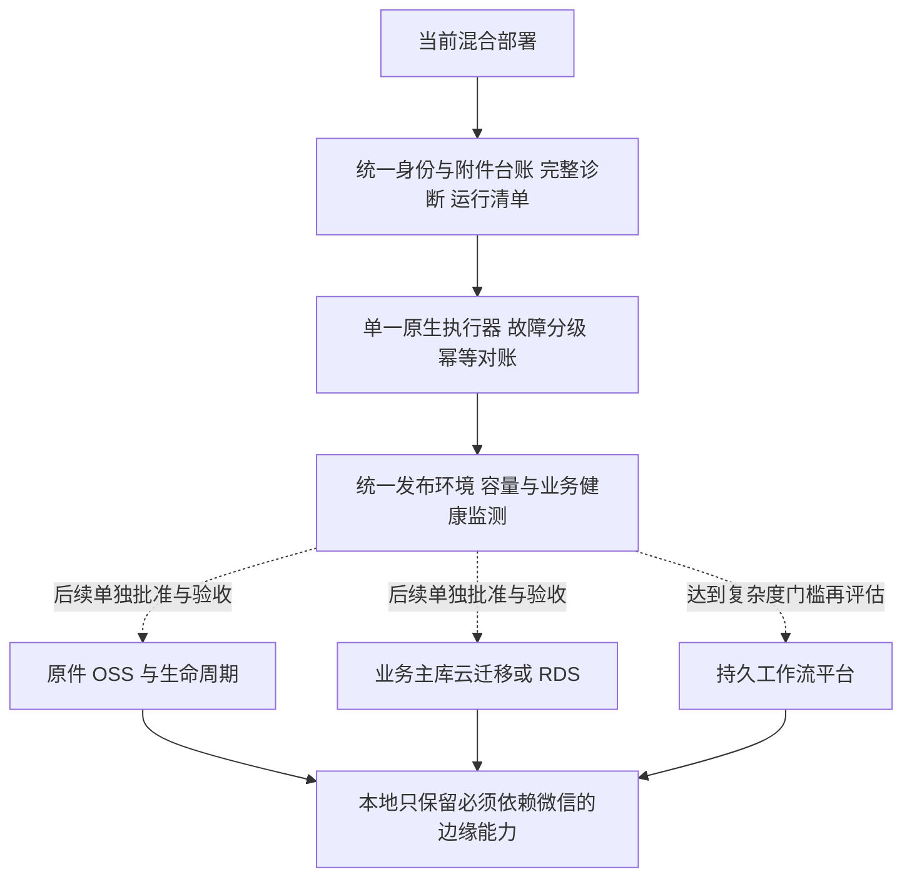

| 顺序 | 具体改进 | 完成判据 | 目前是否实施 |
| --- | --- | --- | --- |
| 1 | 建立每个服务的主机、代码版本、运行时、队列、数据库、负责人清单 | 能从一个入口回答当前运行位置和最后成功时间，尤其是文案生成消费者 | 本文完成架构盘点，自动化运行清单未完成 |
| 2 | 附件统一台账，原生操作唯一执行入口 | 每次尝试有完整终态；未知退出保留保护，已证明安全可恢复；本地与云端原件分别验收 | 局部异常退出修复已部署，完整架构仍待改 |
| 3 | 统一发布依赖与状态校验 | 不再依赖 PATH 猜运行时；锁文件与制品对应；部署后验证业务读写边界 | 存在独立运行时和 manifest，但尚未跨项目统一 |
| 4 | 调度、容量和业务健康指标 | 老任务、最老积压、失败阶段、磁盘阈值、服务退出及恢复均可定位 | 局部状态文件和 timers 已有，完整统一告警待做 |
| 5 | 评估原件迁 OSS | 完整分片上传、哈希核验、授权访问、失败重试、对象对账、删除保护通过 | 建议，未实施迁移 |
| 6 | 再评估主库迁云或 RDS | 单一写入归属、最终追平、序列校准、备份恢复、断网缓冲、切换后回退数据方案齐全 | 用户暂缓，不能直接执行 |
| 7 | 再评估容器和工作流平台 | 用实际部署漂移和任务复杂度证明收益，完成小范围验证后扩展 | 建议，非当前运行组件 |

不建议为了“统一技术栈”同时重写所有前端、切换所有数据库和替换任务平台。当前故障首先是边界与恢复合同不完整；多种技术本身可以共存，但每个运行单元必须有清楚的输入输出、主数据归属、故障范围和验收标准。

## 未确认项与证据清单

| 项目 | 已知 | 尚需补证 |
| --- | --- | --- |
| 文案生成 | 云端存在领取、预览、进度与结果 API | 执行器在哪台机器、是否常驻、模型配置、最近一次成功、租约过期恢复；本次未发现对应常驻服务，不能断言根本不存在 |
| 麦子维护任务 | 最近一次 systemd 任务 failed，网页和业务镜像仍运行 | 具体此次退出原因与影响；不能直接认为所有媒体失败，也不在架构发布中擅自修生产 |
| 血压每日任务 | 线上代码使用进程内定时器 | 时区现场值、漏跑补偿与重启场景的真实验收 |
| 跨项目身份与作品 | 各项目独立数据库和权限实现 | 是否存在未纳入本次检查的统一人员/作品映射服务 |
| 其他本地项目 | 本次覆盖同一 ECS 的实际五站点和相关本地链路 | F 盘其余独立工程未做全盘业务审计，不能宣称所有个人项目都已覆盖 |

本次直接读取了 systemd 单元、Nginx 路由、current 实际目录、部署 package.json、文案服务模块、血压 Node 入口与适配器，以及本地 worker 状态和配置中的非敏感字段。关键源码定位如下。

| 证据 | 支持范围 |
| --- | --- |
| tools/chat-viewer/manage.ps1、server.mjs、cloud-sync.mjs | Windows worker 管理、页面与同步链 |
| tools/chat-viewer/media-pipeline-worker.mjs、media-observer-worker.mjs、下载包装脚本 | 原生下载准入、生命周期与文件观测分工 |
| tools/video-pilot/handoff_runtime.py、business_mirror.py | 确定性交接、等待收尾、单向业务镜像 |
| tools/training-workflow/cloud-worker.mjs、operations、attachment-ingest.mjs | 培训五阶段更新、人工数据隔离和原件入口 |
| ECS /opt/kidney-copy/current/app 与 lib | 文案 Next 路由、SQLite、生成队列、静态选题数据 |
| ECS /opt/hypertension/worker/node 与 src | 血压实际 Node 适配、SQLite 与规则/定时入口 |
| ECS /etc/nginx/conf.d 及 systemd 只读检查 | 五站点实际路由、服务和运行环境 |
| 本地 outputs/project-architecture-20261103 | 本次审计私有记录，不随公开文档发布 |

公开文档不上传生产数据库、源消息、附件、账号、token、部署私有配置或完整远程进程环境。此前附件复盘里的状态时间是 02:19；本文以稍后的架构核查为准，两者不构成全天持续健康保证。
