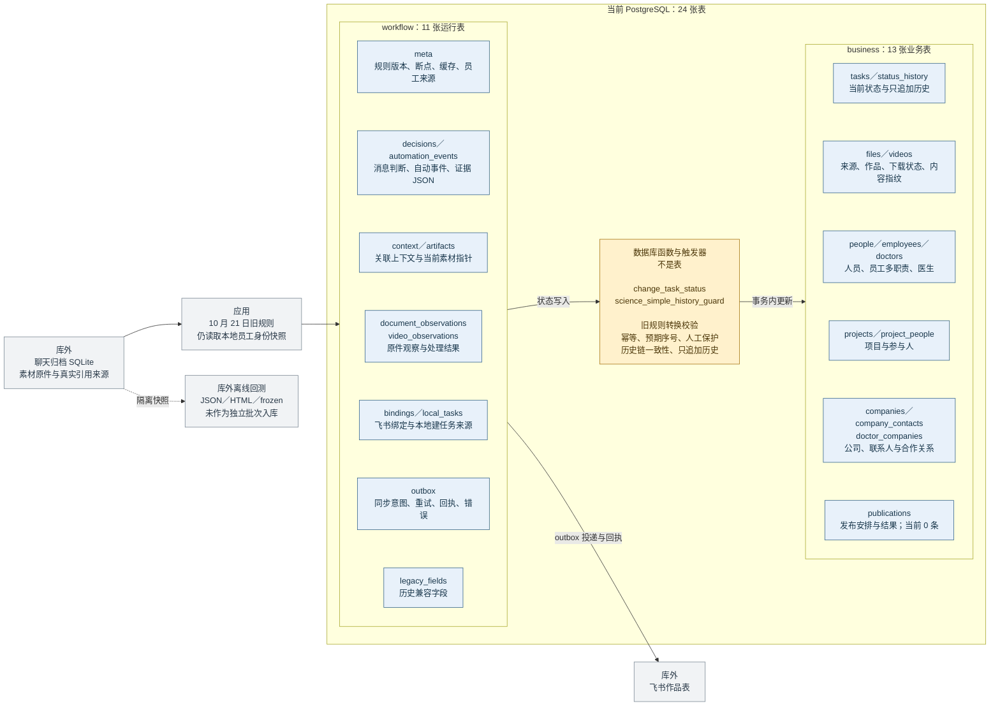
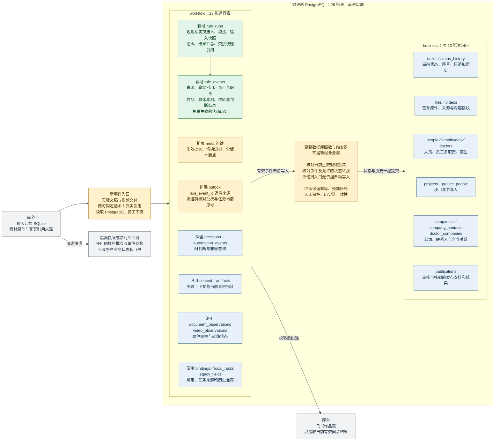
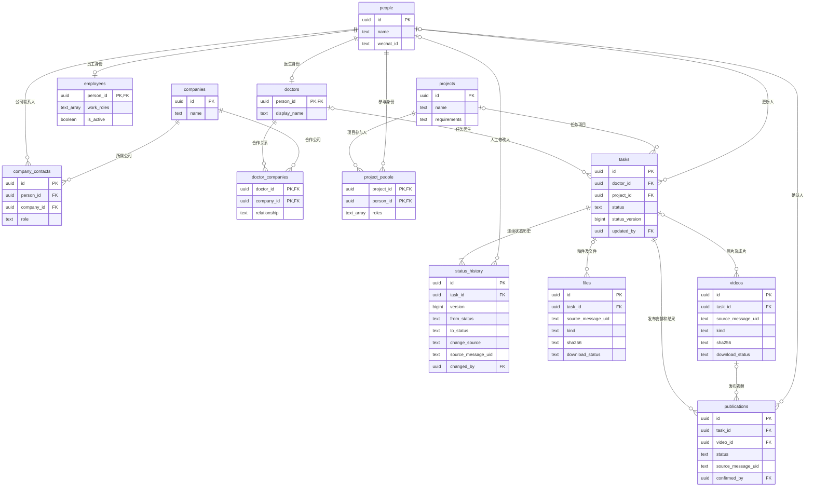

# 状态机当前数据库与新规则升级方案

2026-10-31 v01。当前结构和记录数核验于北京时间 11:27，来自同一次 PostgreSQL 只读一致性快照。后续运行会改变记录数。

**状态、变更历史、事件判断、消息断点和飞书同步记录已经存在。新协议还没有接入生产；需要升级的是事件证据契约、规则版本隔离和切换校验。** 当前数据库包含 `business` 的 13 张业务表、`workflow` 的 11 张运行表，以及 6 个运行视图。当前生效规则仍为 `science-simple-20261021-v1`。

下方“当前结构”描述已经存在的生产库；“更新目标”是本次提出的最小目标设计，尚未执行建表、迁移或切换。目标保留现有 24 张表，在 `workflow` 增加 2 张规则运行与事件审计表，扩展已有同步队列并更新保护函数。新增表名和字段是实施建议，不是已部署事实。

[网页版与可放大图](maizi-state-machine-database-current-and-target-20261031-v01.html) · [当前结构 Mermaid](maizi-state-machine-database-current-and-target-20261031-v01-current.mmd) · [更新目标 Mermaid](maizi-state-machine-database-current-and-target-20261031-v01-target.mmd) · [业务表 ER 图源码](maizi-state-machine-database-current-and-target-20261031-v01-business.mmd)

## 这些能力现在是否存在

| 用户关心的部分 | 当前实际位置 | 已核实的情况 | 新规则需要补什么 |
|---|---|---|---|
| 当前状态 | `business.tasks` | 967 条任务；保存 `status`、`status_version` | 沿用；按证据衔接旧任务，不批量猜测新状态 |
| 状态变更历史 | `business.status_history` | 1,404 条历史；保存前后状态、序号、来源消息、修改来源和时间 | 沿用只追加历史；关联新规则事件依据 |
| 消息判断和事件证据 | `workflow.decisions`、`workflow.automation_events`，以及 `context`、`artifacts` | 7,055 条消息判断、2,186 条自动事件；`detail` 是 JSON 文本，可包含证据消息、视频匹配、选定版本及处理结果 | 已有证据记录不等于最终新协议。补齐可独立追溯的规则版本、真实引用核验、员工职责和具体素材版本 |
| 状态转换校验 | 应用规则模块，以及数据库函数和触发器 | `change_task_status`、`science_simple_history_guard`、历史链一致性和只追加保护均存在并启用 | 更新新规则允许的转换；在正式写入时校验当前规则运行批次 |
| 回测记录 | 本地回测 JSON、HTML、固定样本和测试报告 | 已有离线回测结果；当前 `business`／`workflow` 没有独立回测批次表 | 增加规则运行批次及逐事件结果结构；回测继续在隔离快照或临时库执行 |
| 消息处理断点 | `workflow.meta` | 有 `cursor`、`automationCursor`、`automationRetryCursor`、`activationTs`、`workflowVersion` | 沿用元数据表，补充生效运行批次、交接边界及分版本断点 |
| 飞书同步 | `workflow.bindings`、`workflow.outbox` | 495 条绑定、85 条队列记录；其中 78 条 verified、2 条 reconciled、3 条 conflict、2 条 pending | 沿用队列，增加规则来源和过期校验；切换时处理旧待发结果 |

“事件证据”目前不是一张独立的业务表，“状态转换校验”也不是一张表。前者分散在运行记录和 JSON 中；后者由应用代码、数据库函数、约束和触发器共同执行。消息正文主要仍在本地聊天归档 SQLite 中，通过消息 UID 与 PostgreSQL 关联，不能画成已经搬进 PostgreSQL。

`verified`、`reconciled` 表示飞书同步结果，不代表视频已在内容平台发布。`needs_review` 等判断记录数也不是当前待处理任务数；同一任务可能有多条历史判断。

## 当前生产数据库

此图按用途合并展示节点，括号中的多个名称代表多张真实表。箭头表示数据使用或写入关系，不全部代表数据库外键。业务表真实外键另见后面的 ER 图。

现有机制有四个关键边界：

1. `status_version` 是同一任务内第几次状态变化；它不是规则版本，也不是稿件版本。现有全局规则版本保存在 `workflow.meta`。
2. `decisions` 以消息 UID 为主键；`automation_events` 的事件键不含独立回测批次。这两张表会更新当前处理结果，部分旧结果保存在嵌套 JSON 中，不能直接当作互不覆盖的多版本回测日志。
3. `context.version_uid` 和 `artifacts` 已保存部分素材版本线索；`artifacts` 每个任务和素材类型只保留一个当前指针。它不是完整、不可变的稿件版本与引用证据账本。
4. 员工资料已同步到 PostgreSQL，但当前状态机的身份读取入口仍是本地快照；数据库有员工记录，不等于运行程序已经用上它。

## 更新后的目标结构

绿色为拟新增表，黄色为需要修改的逻辑或结构，蓝色为沿用。两张新增表统一覆盖正式运行、影子观察和离线回测的记录格式，不增加重复的任务、员工、文稿或视频业务表。

### 拟新增和扩展的具体内容

| 位置 | 建议保存的关键字段或规则 | 为什么需要 |
|---|---|---|
| `workflow.rule_runs` 新表 | `id`、`rule_version`、`implementation_hash`、`mode`、输入快照指纹及引用、身份快照指纹、范围、生命周期、结果汇总、交接快照引用 | 说清楚一次运行究竟用了哪版规则、哪批资料；同一消息可以在不同回测批次独立判断 |
| `workflow.rule_events` 新表 | `id`、`run_id`、稳定事件键、核验尝试序号、`source_uid`、`task_id`、员工与职责快照、真实引用消息及核验方式、具体 `file_id`／`video_id`、素材版本或篇目定位、事件种类、核验结果、判断结果、`applied_status_version` | 从一次状态变化反查具体员工、具体消息和具体稿件／视频；材料晚到时追加核验记录，不抹掉原等待原因 |
| `workflow.meta` 原表 | 生效批次、切换时间和消息边界、分版本消息／自动事件／重试断点 | 保留旧断点，明确新规则接管范围；中途失败能继续处理 |
| `workflow.outbox` 原表 | 增加可空的 `rule_event_id` 外键；旧行仍保留。新行发送前校验所属运行批次和任务序号 | 追溯同步来源，防止旧队列覆盖新状态 |
| 数据库状态函数和触发器 | 新自动写入入口必须核对有效事件及生效批次；拒绝缺少新事件依据的旧自动写入路径 | 仅在程序启动时检查版本不够，旧进程不能在切换后继续写入 |
| 原业务表与视图 | 13 张业务表不增删；更新必要默认值和状态转换规则，扩展事件审计视图 | 沿用任务、历史和素材事实，减少迁移范围 |

以上是结构契约，尚不是可执行迁移 SQL。实施时至少落实：运行批次外键；事件到任务、员工和素材的归属校验；核验尝试的唯一约束；事件到 `(task_id, status_history.version)` 的关联；新事件、状态历史和同步意图在同一事务内提交。业务状态变更的幂等仍按“任务＋来源消息”保护，不能因为更换规则版本就允许同一动作重复推进。

素材身份可以复用现有文件／视频记录与来源消息，不需要要求员工手工填写版本号。一份文件有多篇稿件时还需要篇目定位。相同内容可以归为同一作品的相同内容版本，同时保留不同来源消息；不同作品不能仅凭内容指纹合并。旧数据无法补证的引用、岗位或版本不应伪装成已核验。

`rule_events` 的核验与生效记录按尝试追加；同一事件的重复处理不重复改变业务状态。旧 `decisions`、`automation_events` 可继续作为兼容查询或当前结果投影，不能与新事件入口并行争夺状态写入权。

### 最终协议使用哪些事件

| 已约定的标志性事件 | 目标状态 | 新事件记录必须说明 |
|---|---|---|
| 文案人员交出实际稿件或修改稿 | 文案确认中 | 正文已取得，稿件和作品明确 |
| 文案人员引用实际稿件并说“好的老师，我去修改。” | 文案修改中 | 真实引用、员工文案职责、被修改的稿件 |
| 医生交付原片，原件核验并匹配作品 | 待剪辑 | 视频原件、作品匹配及适用范围 |
| 剪辑人员交出对应成片或新版成片 | 成片确认中 | 实际成片和对应作品 |
| 剪辑人员引用成片并说“好的老师，我去修改。” | 剪辑中 | 真实引用、员工剪辑职责、被修改的成片 |
| 发布人员引用最终成片并说“好的老师，我来安排发布。” | 待发布 | 发布职责、真实引用、明确的目标成片 |
| 可核验的平台发布结果 | 已发布 | 具体作品和发布结果，承接话术不等于已经发布 |

医生自由表达不直接触发上述责任交接。旧“待录制”等状态不能机械改名，需要按作品实际证据衔接。首次开剪的工作台入口、“已定时”保留为状态还是进展字段等事项沿用既有讨论中的待定标记，本次数据库图不替这些事项作业务决定。

## 沿用的 13 张业务表及真实外键

此图是当前生产库已存在、目标方案继续保留的核心关系。只列关键字段；状态保护函数不是表，因此未混入 ER 图。文件和视频的任务归属允许暂时为空。`publications` 还通过 `(video_id, task_id)` 组合外键保证发布视频属于同一任务。

## 当前表和视图清单

记录数是这次快照中的行数，不是独立员工人数、完成作品数或已验证事件数。员工表 39 行对应 37 个姓名，包含跨表同名但账号不同的身份记录，不能当作公司当前在职人数。

| Schema | 表名 | 用途 | 快照行数 |
|---|---|---|---:|
| business | `companies` | 公司 | 0 |
| business | `company_contacts` | 公司联系人 | 0 |
| business | `doctor_companies` | 医生与公司合作关系 | 0 |
| business | `doctors` | 医生身份 | 50 |
| business | `employees` | 员工职责和在职信息 | 39 |
| business | `files` | 文件及文稿 | 773 |
| business | `people` | 统一人员身份 | 89 |
| business | `project_people` | 项目参与人 | 0 |
| business | `projects` | 项目 | 0 |
| business | `publications` | 发布安排与结果 | 0 |
| business | `status_history` | 状态变更历史 | 1,404 |
| business | `tasks` | 当前任务 | 967 |
| business | `videos` | 视频 | 2,198 |
| workflow | `artifacts` | 每任务每类型的当前素材指针 | 1,094 |
| workflow | `automation_events` | 自动事件与处理结果 | 2,186 |
| workflow | `bindings` | 任务与飞书记录绑定 | 495 |
| workflow | `context` | 消息与任务关联 | 10,806 |
| workflow | `decisions` | 每条消息当前判断 | 7,055 |
| workflow | `document_observations` | 文档原件观察 | 773 |
| workflow | `legacy_fields` | 历史兼容字段 | 0 |
| workflow | `local_tasks` | 本地任务来源 | 595 |
| workflow | `meta` | 版本、断点、缓存和同步来源 | 1,920 |
| workflow | `outbox` | 飞书同步意图及回执 | 85 |
| workflow | `video_observations` | 视频原件观察 | 2,198 |

当前 6 个 `workflow` 视图是 `task_progress`、`recent_decisions`、`document_inventory`、`video_inventory`、`automation_attention`、`processing_summary`。视图是已有表的查询组合，不额外存一份业务事实。

`projects`、`project_people` 和 `publications` 在本次快照中均为 0 行。这说明表结构存在，但这些内容尚未完整入库；不能把“数据库已经设计了该表”写成“业务数据已经全部接通”。

## 版本切换如何使用这些结构

1. 在隔离环境安装增量结构和新规则入口；回放冻结快照，输出每个事件的作品、素材、角色、引用和目标状态。旧 Golden 样本保留，新协议另增版本。
2. 为进行中的任务生成交接清单，区分可由证据确定的状态和待核对项。人工改动、终态和旧历史保留；不直接清空 `decisions`、历史或消息断点。
3. 短暂停止旧状态写入及飞书回写，等待在途事务结束，保存切换快照和普通消息、自动事件、重试三个处理边界。消息采集与素材下载可继续。
4. 更新数据库规则校验、程序版本和 `activeRuleRunId`。在提交状态的事务内核对生效批次，防止旧进程继续自动写入；新规则不再让旧聊天语义入口直接改状态。
5. 核对旧 outbox：已确认完成的保留；尚未发送且被新结果替代的标记为已取代并由投递器明确排除；在途结果不明的先回读飞书。仅增加一个队列状态名称不够，发送选择条件和同任务前序阻断条件都要同步支持。
6. 核验新规则处理和回写后恢复正式运行。晚到的旧素材可补充关联并重新核验，但不能不加判断地覆盖较新的状态。失败时暂停自动写入，保留切换后收到的消息、证据和历史；不整库覆盖回旧备份。

回测模式不能调用生产状态变更和飞书投递。上线验收必须运行 `npm run test:video-golden` 和涉及模块测试，覆盖临时 PostgreSQL 迁移、旧写入拒绝、同消息重试、引用旧版本、素材晚到、人工状态保护与旧队列收敛。Golden 通过不等于真实语音识别或原生微信下载已经验证。

## 依据与发布范围

当前结构依据生产库 `information_schema`、`pg_constraint`、启用的触发器及一致性快照计数核验；规则行为依据当前 `workflow_policy.py`、`science_workflow.py`、`postgres_state_store.py`、`live_state.py` 和 `workflow_automation.py`。数据库建表来源包括 `maizi-business-schema.sql`、`task-workflow-postgresql.sql`、`science-simple-20261021.sql` 和 `science-receipts-20261023.sql`；旧建库说明中的“空库／尚未接入”不代表本次运行现状。

新业务协议以 [文稿与视频驱动的交接状态机讨论总结](../artifact-handoff-summary-20261031/maizi-artifact-handoff-thread-summary-20261031-v01.html) 为依据；旧结构与部署历史可查 [任务数据库文档](../task-model-20261017/maizi-task-database-20261017-v01.md)。本页目标结构是对这些约定的技术实施建议。

本次仅发布结构说明、Mermaid 源码及渲染图，不执行数据库迁移或生产规则切换。公开内容不包含原始聊天、员工姓名清单、消息 UID、附件地址、数据库凭据或私有回测结果。
