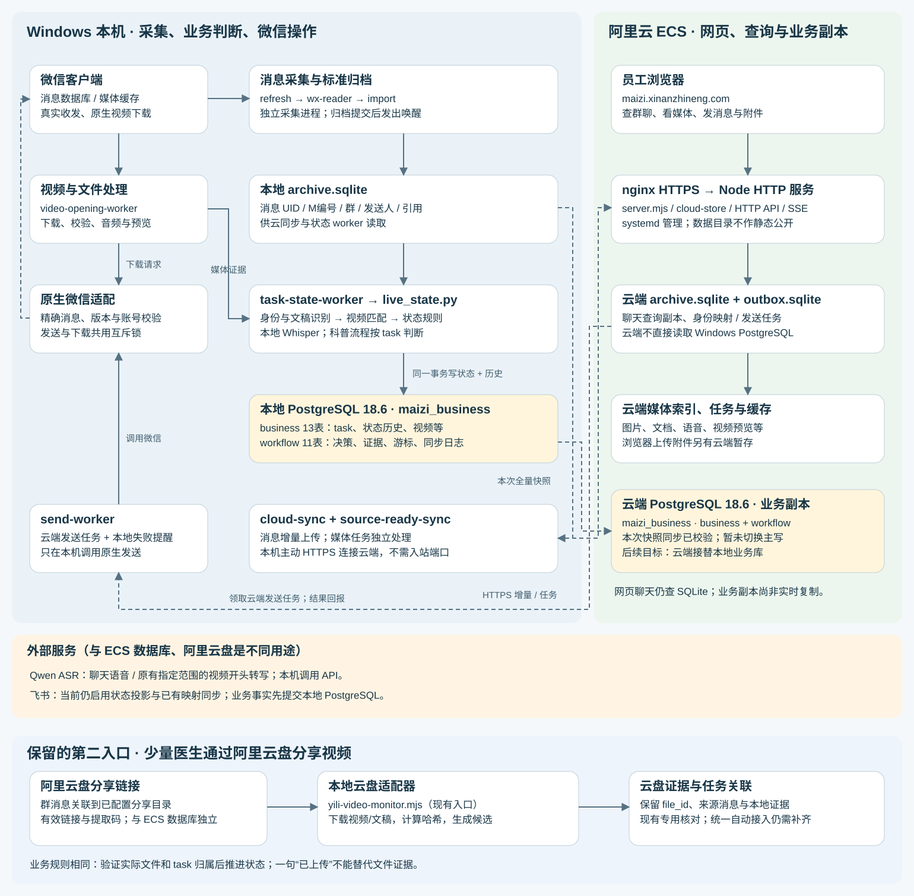
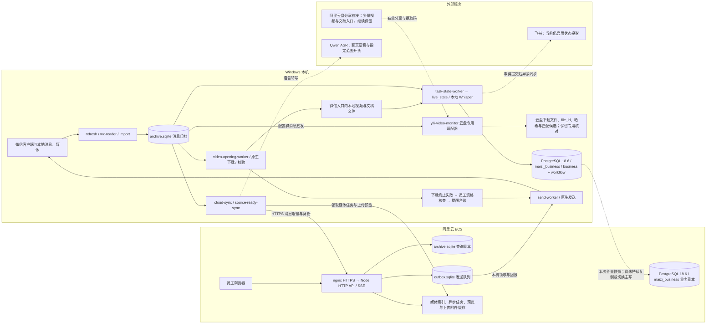
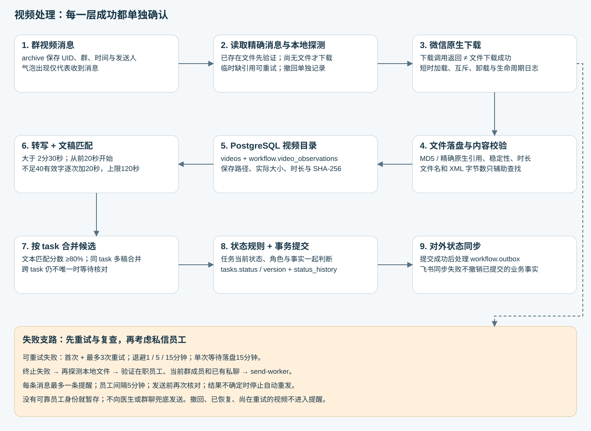
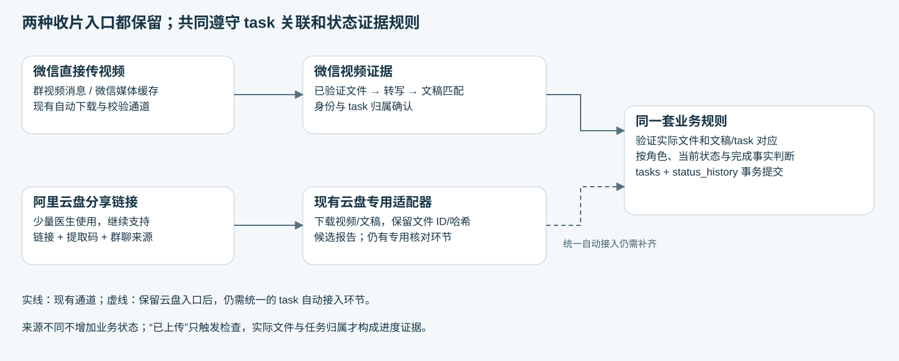

# 科普麦子当前系统结构与运行细节

核查时间：2026-10-23 04:32 北京时间（下图为历史快照）

2026-10-27 06:00 更新：Qwen 状态判断已在常驻 worker 开启 apply；PostgreSQL 每60秒单向镜像程序完成隔离测试，因阿里云登录过期尚未部署云端接收端。数据库仍未持续同步。“最新业务副本”仅指10月23日快照时刻。

[飞书回写异常逐条清单](maizi-feishu-sync-issues-20261027.html)：当前表内48条，旧绑定且记录已无法读取16条。

## 01 / 数据库到底在哪里

**当前应用仍主写本地，阿里云 PostgreSQL 已有最新业务副本。**已用生产配置建立只读连接，实际服务返回 `127.0.0.1:5432 / maizi_business`，版本为 PostgreSQL 18.6（Windows）。阿里云 ECS 同时承载 PostgreSQL 18.6 业务副本、聊天网页与 SQLite 查询副本。本轮已完成全量快照同步；持续增量复制和应用主库切换尚未实施。

“阿里云”目前涉及三件不同的事：ECS 提供网页与 PostgreSQL 业务副本；Qwen 提供语音转写 API；阿里云盘继续作为少量医生的视频和文稿收取入口。微信直接传输为主、云盘分享链接为辅，两种方式都保留；ECS、Qwen 与云盘是不同用途。

这是 **2026-10-23 04:32 北京时间** 的运行快照。业务库只读核查：tasks 502、videos 965、files 302、status_history 621；projects 表已建，但当前 0 行，不能误认为项目归属已经全部自动建立。视频目录数包含历史与其他来源，不能当作当前新视频下载成功率。

云端 HTTPS 全量核查通过：205,644 条消息、402 个有消息会话，消息数与本机归档一致；未登录访问受限，数据库和凭据路径不能直接下载。本次已通过阿里云云助手实查 PostgreSQL、服务与端口，并执行经过暂存库核验的业务快照同步。PostgreSQL 只监听 ECS 环回地址，没有开放公网数据库端口。

## 02 / 系统部署结构图

主链路按部署位置划分。虚线表示跨组件异步传递；节点内列出具体模块。视频失败与私信的细节见下一张图。

[打开完整 SVG](maizi-system-structure-20261023-v03.svg) · [下载 Mermaid 源码](maizi-system-structure-20261023-v03.mmd)

## 03 / 数据存在哪里、谁负责写

<table><thead><tr><th>存储</th><th>部署 / 路径</th><th>内容与读写关系</th></tr></thead><tbody>
<tr><td>微信原始消息与媒体</td><td>Windows 微信账号目录；`db_storage`、`msg/video/YYYY-MM`、`msg/file/YYYY-MM`</td><td>微信维护原始数据。采集器读取消息；微信客户端执行真正的网络下载。没有把视频二进制存进 PostgreSQL。</td></tr>
<tr><td>本地消息 SQLite</td><td>`outputs/chat-viewer/archive.sqlite`</td><td>import 写入标准消息、会话、媒体关联、元信息与全文索引；cloud-sync 和 task-state 读取。M编号便于人工定位，UID 用于跨模块追溯和幂等。</td></tr>
<tr><td>业务 PostgreSQL</td><td>本机 `127.0.0.1:5432 / maizi_business`</td><td>`business` 保存业务事实；`workflow` 保存处理进度、判定证据与飞书待同步项。通过状态 worker / 受控人工处理路径写入。</td></tr>
<tr><td>下载过程与文件校验</td><td>`outputs/chat-viewer/video-downloads/`、`video-openings/`、`video-file-checksums.sqlite`</td><td>每条消息请求、尝试次数、失败原因、落盘证明与开头报告；校验缓存按路径及文件属性失效。它们是处理台账和缓存，不替代任务状态历史。</td></tr>
<tr><td>本地员工提醒台账</td><td>`outputs/chat-viewer/video-download-alerts.sqlite`</td><td>按消息 UID 去重，保存员工选择、提醒状态与发送不确定性。send-worker 消费；不写入云端发送 outbox。</td></tr>
<tr><td>云端业务 PostgreSQL</td><td>ECS 环回地址 `127.0.0.1:5432 / maizi_business`</td><td>24 张业务/运行表已全量同步到 2026-10-23 04:24:13 快照，逐表全部行内容指纹一致。当前未有云端状态 worker 消费复制过来的 outbox；不是实时热备，也未接替本地应用连接。</td></tr>
<tr><td>云端消息 SQLite</td><td>ECS `/opt/maizi-viewer/data/archive.sqlite`</td><td>cloud-store 接收 HTTPS 增量。网页查询聊天、姓名、上下文等；不是 PostgreSQL 复制，也不包含完整 business 状态库。</td></tr>
<tr><td>云端发送 SQLite</td><td>ECS `/opt/maizi-viewer/data/outbox.sqlite`</td><td>网页排队发送消息/附件；Windows send-worker 领取、执行、回报。云服务本身不操控微信。</td></tr>
<tr><td>云端媒体与附件</td><td>ECS data 下图片、文档、语音、视频预览及 send-attachments 等子目录</td><td>媒体索引、领取任务、转写结果、预览与缓存。浏览器主动上传的发送附件会暂存在云端；这不等于自动上传全部接收视频原件。</td></tr>
<tr><td>旧数据与兼容入口</td><td>旧 `xiaoxifenliu` PostgreSQL 设计、迁移前 business/runtime SQLite、旧 postgres-sync 状态文件</td><td>保留历史和迁移依据；本次核实的当前 task 状态 writer 指向 `maizi_business`。旧文件名、旧成功状态和 10月6日文档不能用于判断当前主库。</td></tr>
</tbody></table>

**三个用途不同的任务台账：**云端 `outbox.sqlite` 排队微信发送；PostgreSQL `workflow.outbox` 排队飞书状态同步；本地 `video-download-alerts.sqlite` 单独记录下载失败后的员工提醒。

## 04 / PostgreSQL 里面具体有哪些表

当前实际包含 13 张 business 表和 11 张 workflow 表。UUID 用于身份，不用来判断新旧；同一 task 的状态顺序使用 `status_version / status_history.version`。

<table><thead><tr><th>business 表</th><th>用途</th></tr></thead><tbody>
<tr><td>`people`</td><td>人员基础信息与微信身份。</td></tr>
<tr><td>`doctors / employees / company_contacts`</td><td>医生、员工、公司联系人的角色扩展。公司人员在当前实现中表名为 company_contacts。</td></tr>
<tr><td>`companies / doctor_companies`</td><td>公司与医生合作关系。取消“项目与公司关联”没有删除这两张表。</td></tr>
<tr><td>`projects / project_people`</td><td>项目及项目参与人；tasks.project_id 关联项目。</td></tr>
<tr><td>`tasks`</td><td>一份内容对应的任务，记录医生、项目、类型、当前状态、状态版本等。</td></tr>
<tr><td>`files / videos`</td><td>文稿及视频各自直接挂 task；不要求 file 与 file、video 与 video 建版本链。来源 UID 连回消息；本地路径、校验和、下载状态用于机器核验。</td></tr>
<tr><td>`status_history`</td><td>每次生效状态变更，含 from/to、version、时间、来源、操作者、源消息 UID。</td></tr>
<tr><td>`publications`</td><td>发布记录及播放量等；联合外键约束 video_id 与 task_id 属于同一任务。</td></tr>
</tbody></table>

`workflow.meta`：游标与缓存元信息；`bindings`：任务与飞书记录映射、启用/挂起；`decisions`：逐消息判定；`context`：任务上下文；`artifacts`：当前素材证据；`outbox`：状态同步；`local_tasks`：本地自动接入任务；`document_observations / video_observations`：文件、视频的来源与处理观察；`automation_events`：自动接入判定；`legacy_fields`：旧字段迁移留存。

生效一次状态转换时，在同一个 PostgreSQL 事务中校验当前状态/版本，更新 tasks，追加 status_history，并登记对应处理结果和需要的同步项。重复证据不会重复推进；异常回滚。源消息通过 `source_message_uid` 回查归档。人工变更仍要有来源和操作者，不能只裸改 tasks.status。现有复核工具和数据库契约支持受控处理，不能据此说云网页已完整提供业务改状态入口。

[现有 ERD 与逐字段说明](../task-model-20261017/maizi-task-database-20261017-v01.html)（该页持续维护）；本页只说明当前系统如何把这些表串起来。

## 05 / 视频如何下载、匹配与推进任务

[打开视频链路完整图](maizi-system-structure-20261023-v03-video.svg)

[打开两种入口对照图](maizi-system-structure-20261023-v03-inputs.svg)

微信原生下载通道的当前主动下载范围是上线时间之后的入站群视频；不是所有历史消息、私聊和自己发送的视频。视频不超过 2分30秒时，仍可进入下载/目录流程，但按当前科普规则不做推进状态所需的内容分析。阿里云盘链接使用独立云盘适配入口下载视频和文稿，继续保留。两类文件的来源不同，业务上仍要关联到同一个 task，再按证据推进状态。

先按精确消息找本地文件，再考虑原生下载。内容 MD5 命中时不因微信改文件名或 XML 大小相差 1 字节而拒绝；另一条验证路径是精确原生消息文件引用加时长等检查。没有可靠内容或消息引用证据时，不能挑一个大小近似的文件凑数。SHA-256 保存在业务目录，便于确认后来读到的是否仍是同一份文件。

业务匹配使用本地 Whisper large-v3-turbo：先转前20秒；不足40个有效字符再转20秒并累积，最多120秒或到视频结尾。40字是继续取音频的阈值，已不作为直接拒绝匹配的门槛；有效短文本仍按当前规则计算匹配。分数达到80%后以 task 合并候选，同 task 不同文稿不会误报不唯一；两个不同 task 都达标仍需核对。

另有聊天展示转写链路使用 Qwen ASR，包括语音消息与原来配置的指定群视频开头。它与全群科普业务状态转写是两条链路；不能把启用 Qwen 等同于业务状态模型已经切换到 Qwen。FFmpeg 负责音频抽取、转码和预览。

请求可重试失败时，最多首次加3次重试，退避1/5/15分钟；每次等待落盘最长15分钟，原生请求之间另有协调冷却。每次请求持久化 UID/尝试号，恢复时先复查文件，避免重复派发。同一消息的“请求已返回”“文件已验证”“目录已入库”“状态已推进”分别记录，不能合并为一个成功。

阿里云盘链接入口继续保留

少数医生可在群里发阿里云盘分享链接，或在已配置分享目录上传后发消息告知。处理入口与微信视频气泡并列保留：读取分享目录 → 下载实际视频和相关文稿 → 保留来源与文件校验信息 → 关联 task → 按同一套科普规则判断状态。

**已存在的实现：**`refresh.mjs` 的业务处理回调仍调用 `handleUploadMessages`；`yili-video-monitor.mjs` 从私有配置读取群、医生、分享链接、提取码与目录，下载视频和候选文稿，记录云盘 `file_id`、触发消息、SHA-256、本地路径及开头证据。当前配置实例是仪丽群；链接和提取码不写入公开文档。已处理文件有记录用于避免重复处理。

**当前实现范围：**专用适配器使用目录和上传时间预筛候选，报告仍可能等待核对。它不是已完成全群通用自动接入的证明，也不能把时间预筛分当成文稿内容80%匹配。后续统一时，两路均采用当前 task 关联与状态规则；不新增云盘专属业务状态，不因交付来源不同把同一文稿拆成两个 task。

统一接入约定：保留群聊来源消息 UID、云盘分享来源/文件 ID、下载路径及实际文件哈希；原有专用报告已有其中的文件 ID、触发消息与哈希。微信原生消息下载句柄仅用于微信通道。链接过期、提取码错误、无权限或目录不可见时记录该入口的失败，保留其他采集和微信视频流程；不能凭“已上传”把任务当作已取得视频。

已明确绑定 task 的云盘下载异常应交由群内员工协助处理，不联系医生；现有自动私信模块只扫描微信原生视频下载终止失败，云盘适配器的错误尚未统一接入该自动提醒台账。

## 06 / 当前 task 状态与证据规则

文案待医生确认 ↔ 文案修改中 → 待录制 → 待剪辑 → 剪辑中 → 成片待医生确认 ↔ 成片修改中 → 待发布 → 已定时 → 已发布

这是阅读顺序，不是所有相邻状态都能任意跳转。实际版本 `science-simple-20261021-v1`：医生确认文案后待录制；已下载、已匹配文稿的医生原片可以直接证明进入待剪辑；匹配成片明确交付可进入成片待医生确认，无需先等一句“开始剪”；医生确认成片进入待发布；定时/发布需要完成事实，计划、疑问、否定不算完成。

医生要求修改只记录正在修改，不强制提取每条修改意见。明确已发布可以直接证明已发布，不补造中间审核记录。已发布以及暂停、异常、已取消、已下架不由自动规则继续推进。身份未知、跨 task 歧义或文件尚未验证时保留证据、等待处理，不猜状态。企业审核不再单独拆成当前科普主状态。

## 07 / 网页发送、员工提醒与安全边界

网页发送：浏览器 → 云端鉴权和发送队列 → 本机 send-worker 领取 → 账号/版本/群与附件校验 → 原生微信发送 → 结果回报。发送与下载共享原生操作互斥，不同时争用微信；发送结果不确定时先停下，不能自动重发造成重复消息。

新加的下载提醒已启用。只扫描启用之后形成的终止失败（重试耗尽或明确不可重试），排除仍在重试、撤回和已恢复。先再次探测文件，再核对在职员工名册、微信映射和当前群成员；还要求已有私聊会话。有冲突、无确认员工或不能安全发送时暂存，不能换成医生或群发。每条失败消息最多一条提醒，同员工间隔5分钟；实际发送前再复核文件与收件人。

提醒文本包含群名、视频消息时间、发送人和 M编号，请员工检查能否打开、必要时重发。云端普通发送任务优先，本地提醒只在空闲时领取；本地提醒结果留在本地提醒库。提交原生发送不等于对方已经收到或已读。本次文档核查没有向任何联系人发送测试消息。

## 08 / 运行方式、同步与故障影响

<table><thead><tr><th>模块</th><th>运行与恢复</th><th>故障时的影响</th></tr></thead><tbody>
<tr><td>Windows 进程管理</td><td>`manage.ps1` 分别管理 viewer、refresh、cloud-sync、source-ready-sync、video-opening、task-state、send-worker；现有 Windows 恢复计划任务检查进程。进程锁/业务库锁防止重复 worker。</td><td>进程还活着不等于业务健康，需要结合 JSON 状态、游标与错误；主动暂停应被恢复机制尊重。</td></tr>
<tr><td>消息归档与云同步</td><td>按稳定编号分批上传；消息同步有文件事件唤醒与约5秒兜底轮询。图片、文档、视频、语音转写在独立任务中处理。</td><td>网络中断后从云端确认游标续传；本地游标落后云端时拒绝覆盖。没有跨 SQLite/PostgreSQL 的分布式事务。</td></tr>
<tr><td>业务 worker</td><td>归档和视频证据唤醒，另有恢复轮询；身份快照、目录与判定分别处理。</td><td>PG 不可用时不能提交业务状态；未提交事务不应被当成已完成。下载完成不保证文稿唯一匹配。</td></tr>
<tr><td>ECS 网页</td><td>nginx HTTPS；Node 服务监听环回地址；`maizi-viewer.service` 托管。代码发布目录与 data 分开。</td><td>Windows 离线时仍可查看已有云历史；新的下载、转写准备、状态推进和真实发送无法仅靠云服务完成。</td></tr>
<tr><td>飞书投影</td><td>当前健康配置 `feishuSyncEnabled=true`；先本地提交，再持久化 outbox 异步同步/回读。</td><td>远端失败留待重试/核对，人工冲突需处理。用户希望替代飞书，但代码当前仍依赖部分映射/目录，尚未完成脱离。</td></tr>
</tbody></table>

阿里云已有经过恢复与内容核验的 PostgreSQL 业务快照副本，并保留上一个云端库和 dump。它尚非持续复制的热备；本地在快照之后的新写入不会自动进入云端。接替主库仍需持续增量/最终追平、业务连接切换、断网恢复与回退验收。

关键配置与排查入口
<table><thead><tr><th>配置 / 状态文件</th><th>当前用途与关键值</th></tr></thead><tbody>
<tr><td>`config/task-state-live.local.json`</td><td>业务后端 PostgreSQL、身份快照、视频目录、workflowMedia、本地事务与飞书目标。当前 workflowVersion 为 science-simple-20261021-v1，业务音频模型 large-v3-turbo。</td></tr>
<tr><td>`config/chat-video-opening.json`</td><td>自动下载已开启；全群新视频起点为 2026-10-17 23:44:43 北京时间；最大配置下载体积1024MB；原件自动上传关闭。chatIds 另管原有开头分析范围，全群下载不等于全群走原有 Qwen 开头分析。</td></tr>
<tr><td>`config/chat-viewer-cloud.json`</td><td>云同步开关、站点地址与独立同步凭据；令牌只在本机私有配置中保存。</td></tr>
<tr><td>`config/chat-viewer-send.json`</td><td>发送开关和当前微信账号、进程、版本绑定；微信重新登录/升级后需要重新验证绑定。</td></tr>
<tr><td>`config/chat-video-download-alerts.json`</td><td>员工提醒已启用，enabledSince 限制启用后的失败，recipientCooldownMs=300000；身份来自在职名册与微信身份配置，再实时检查群成员。</td></tr>
<tr><td>`outputs/task-state-live/health.json`</td><td>业务后端、游标、目录、媒体识别、自动接入、飞书同步和覆盖状态。应逐项读取，不能只看进程 PID。</td></tr>
<tr><td>`outputs/chat-viewer/*-status.json`</td><td>cloud-sync、send-worker、source-ready-sync、video-download-alerts 分别记录在线、检查时间与处理结果；单条视频另查 video-downloads 下日志。</td></tr>
</tbody></table>

云端原件/预览请求通过本机主动领取。source-ready 提示仅覆盖最近72小时内已确认且未变化的文件；它是加速预览准备的提示，不是所有历史文件的同步承诺。浏览器原件、预览、转写各有独立任务状态，某个预览可播放不代表 business 任务已匹配或已发布。

## 09 / 已知限制与后续改进

**已落地：**幂等重试、精确消息读取、内容校验、不同文件名/字节偏差恢复、目录暂时失败重试、员工私信失败支路。刚完成的全量人工审计记录为749条适用群视频：748已取得文件、1条下载前撤回。这是当次核查范围和结果，不承诺后续零失败。

**仍待完善：**原生下载最终网络完成/错误回调尚未提供可用诊断；调用返回不证明网络成功，所以部分失败无法直接定性为过期、网络或微信内部问题。持续定期执行“源消息→本地文件→校验→PG目录”的完整审计仍是改进计划，现有扫描和唤醒不等于已部署这项全量端到端审计。

本次读取的业务健康快照显示 businessOk=true、videoCatalog.ok=true，但 businessCoverageOk=false，整体 ok=false；仍有需核对的业务归属/历史来源问题。不能因云同步在线或下载回归通过，就写成整个系统全部自动化成功。

## 10 / 核查与测试依据

本版修正阿里云盘入口的表述、结构图与实现范围，没有修改运行代码、数据库或同步配置。重新运行 `npm run test:video-golden`（全部版本210/210，自适应开头11项）及 `node --test tools/chat-viewer/capture-publish.test.mjs tools/chat-viewer/capture-issues.test.mjs`（5/5），均通过。后者含云盘链接过期不阻塞归档、后续可重新处理失败输入的模拟场景。此前下载、员工提醒、快照同步与传输模块测试记录见 v02，本轮没有重新执行这些模块。

这些回归验证规则、数据契约与适配行为，不是真实 ASR 准确率评测，也不是本轮原生收发/下载的真机验收。原生下载能力与历史实测参考下载复盘；本次未调用真实转写 API 做准确率评测。

核心核对文件：`config/task-state-live.local.json`、`config/chat-video-opening.json`、`config/chat-video-download-alerts.json`；`server.mjs / db.mjs / cloud-store.mjs / cloud-sync.mjs / source-ready-sync.mjs / send-worker.mjs / video-download-alerts.mjs`；`postgres_state_store.py / live_state.py / workflow_media.py / science_workflow.py / video_catalog.py`；部署说明及 `deploy-cloud.py`。配置只公布用途和必要地址，不公布账号、密码、Token 或微信媒体临时密钥。

快照实现参考 PostgreSQL 官方 [pg_dump](https://www.postgresql.org/docs/18/app-pgdump.html) 与 [pg_restore](https://www.postgresql.org/docs/18/app-pgrestore.html) 文档。

本版核查与回归日志：`outputs/aliyun-drive-doc-correction-20261023/`；此前系统实查日志：`outputs/system-structure-20261023/`；发布文档不包含原始聊天数据或运行凭据。[10月22日下载复盘](../video-download-20261022/maizi-video-download-review-20261022-v01.html)是历史快照，之后的组合校验修复和员工提醒以本页为准。

## 11 / 本次阿里云同步结果与后续目标

**目标是云端 PostgreSQL 最终接替本地业务库。**当前完成的是最新全量快照同步，持续增量复制与主库切换尚未完成。

2026-10-23 04:24:13 北京时间快照，04:28:20 更新云端。business 13表、workflow 11表的行数与全部行内容指纹一致；502个 task、965条视频记录、302条文件记录、621条状态历史。状态版本/历史契约通过。

先核对云端仍与昨天已验证基线一致，再在独立暂存库恢复，验证后保留原库并交换副本名称。旧云端库与恢复前 dump 均保留。写入账号不是超级用户，读取账号不能插入，两者均不能改写历史；原有网页、培训服务与 PostgreSQL 均为 active。临时上传进程已停止、nginx 临时路由已移除。

本地视频路径作为元数据保留，视频二进制没有随数据库上传。当前云网页的聊天查询仍使用 SQLite，云 PostgreSQL 业务副本不会自动改变网页查询来源。切换前仍只有本地业务 worker 主写，避免两边重复消费同步 outbox。

后续目标链路：Windows 微信采集/媒体处理 → 可靠重传 → 云端业务接入与唯一状态处理 → 云端 PostgreSQL → 业务网页。仍需实施增量同步/最终停写追平、受控连接、唯一 worker 切换、本地文件访问、断网补传及回退演练。本页不把这些后续步骤画成已上线。

补充：v01 只核对了当前应用连接，遗漏了昨天已建并导入快照的云 PostgreSQL；本版已补充实查与同步结果。[v01 原版](maizi-system-structure-20261023-v01.html)保留供追溯。
