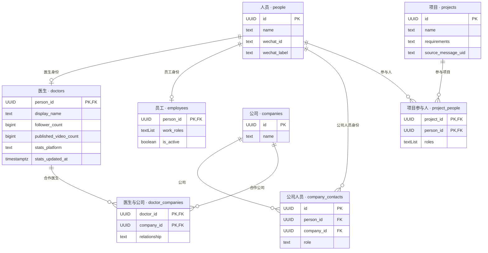
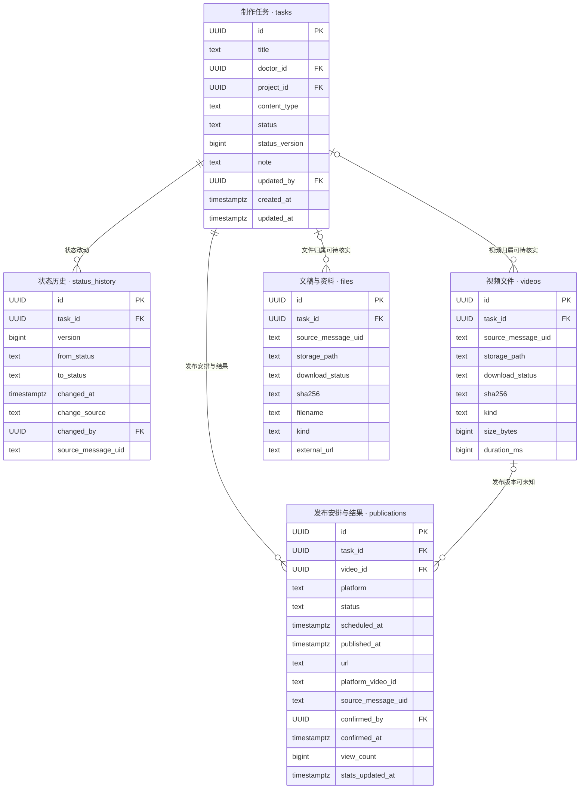
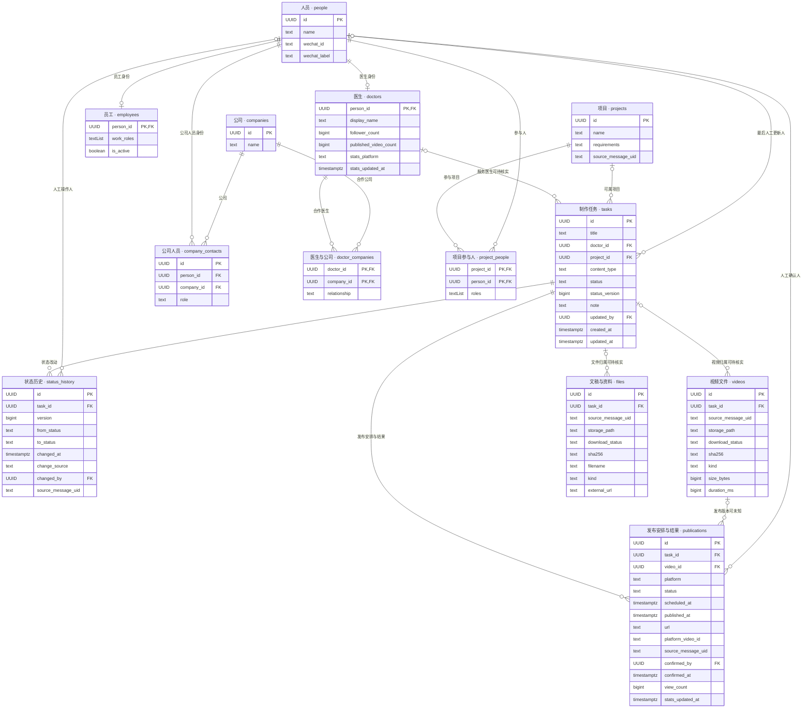

# 麦子工作台：task 核心数据库与字段目录

2026-10-17 v01｜设计稿。13张业务表，优先自动获取，人工保留纠正入口。

[网页与放大图](maizi-task-database-20261017-v01.html)

## task级匹配修复（2026-10-21）

只分析严格超过150秒的视频，取前20秒转写。每个task下的不同文稿只算一个候选，取最高匹配分数；只有一个不同task达到80%时才自动关联。取消40字转写门槛和15个百分点分差门槛；多个不同task同时达到80%仍待核对，空转写不匹配。

新视频不再沿用前一篇文稿的任务。已有自动挂靠与当前内容匹配冲突时，核验同一医生、原件、当前规则及唯一达标task后纠正，并保存原task、新task、依据消息与分数。人工确认过的关联或状态、已用于发布记录的视频不自动覆盖。任务状态仍通过事务和status_history推进，既有历史不改写，原任务进度不因移走视频而自动倒退。

收件说明不再要求医生声明批次条数。原片按对应文案独立推进；旧收齐／条数待处理记录被新判定替代，原依据保留。未下载、未达80%、类型未知等真实问题仍保持待处理。匹配缓存带规则版本，旧缓存会按新规则重算，可复用前20秒转写，不强制重复调用ASR。

落地核对：7条原有关联冲突均已纠正；张娟M199566同task多文稿正常匹配（86.84%）；王江敏M198060短转写正常匹配（94.59%）。李荣红M196476为76.92%，继续待核对。张娟M199564、房医生M199361仍因任务类型未知而不自动推进。旧收齐／条数等待残留为0条。

| 消息ID | 医生 | 分数 | 文稿 | 落地结果 |
|---|---|---|---|---|
| 198110 | 孟祥雨 | 86.49% | KP18 孟祥雨 Z 晚上睡觉的四个信号，可能提示糖尿病加重 | 关联正确；待剪辑 |
| 198113 | 孟祥雨 | 95.83% | 为什么有人吃饱了还想吃？ | 关联正确；待剪辑 |
| 199563 | 张娟 | 97.18% | KP5 张娟 zys 孩子肥胖别忽视四个检查 | 关联正确；待剪辑 |
| 199564 | 张娟 | 88.61% | 肚子大的脂肪肝，比看得见的胖更危险 | 关联已纠正；类型未知，状态不自动推进 |
| 199614 | 陈贝健 | 83.33% | KP 151 CX 陈贝健 哪种身材最健康 | 关联正确；待剪辑 |
| 199618 | 陈贝健 | 90.28% | KP 150 CX 陈贝健 你以为是胃疼，其实是心梗？教你5个办法，关键时刻能救命 | 关联正确；待剪辑 |
| 199361 | 房医生 | 91.49% | 你可以熬夜，但你必须学会暴力修复 | 关联已纠正；类型未知，状态不自动推进 |
| 199566 | 张娟 | 86.84% | KP2 张娟 zys  减肥总失败？你可能不是嘴馋是代谢卡住了 | 关联正确；待剪辑 |
| 196476 | 李荣红 | 76.92% | 候选：女性多胖才算胖？卫健委标准告诉你 | 未达80%，保留待核对 |
| 198060 | 王江敏 | 94.59% | KP5 王江敏 crh 哪些日常习惯能帮你平稳控糖？ | 关联正确；待剪辑 |

验证：npm run test:video-golden通过；新增冻结v6，保留v1—v5全部样本，当前46个场景、历版合计159次回放。其中新增10条真实视频消息，使用186份已读取文稿和既有前20秒转写。PostgreSQL及匹配模块共129项测试通过，其中本轮新增13项（6项匹配测试、7项临时PostgreSQL测试）；包含实际运行账号权限验证。另通过live适配器44项、worker1项、Qwen适配器4项、转写队列1项、视频开头6项。

测试只使用固定转写、临时库和模拟接口，不发送微信消息、不重启微信、不用样本写生产库；这不是一次新的真实ASR准确率评测。portable golden中的2个旧本地媒体场景仍未执行。生产纠正是通过测试后的独立授权操作；现有状态历史逐行核对未被改写。

## 当前简化状态机（2026-10-21已部署）

2026-10-21 已部署 science-simple-20261021-v1。当前只自动推进科普；患教、类型未知、身份或任务关联不明确的情况留待人工。任务以同一医生的文案正文识别，改文件名、重发同内容不另建 task。

| 状态 | 进入条件 |
|---|---|
| 文案待医生确认 | 收到有完整标题和正文的正式文案时建 task；修订稿重新提交也回到这里。 |
| 文案修改中 | 医生要求改文案；只需识别正在修改，不要求提取每条意见。 |
| 待录制 | 医生对唯一任务的文案明确确认。 |
| 待剪辑 | 医生原片已下载、超过2分30秒，前20秒与文案唯一匹配；不再等“录完了／收齐了”。 |
| 剪辑中 | 有明确开剪消息；没有这句话也不阻塞后续成片。 |
| 成片待医生确认 | 剪辑师交付的成片匹配上文案；可以跨过缺失的录制／开剪消息。 |
| 成片修改中 | 医生要求修改成片；补录、换素材不另设状态，不因此退回待剪辑。 |
| 待发布 | 医生明确确认当前任务的成片；不要求先选定某个文件版本。 |
| 已定时 | 员工明确说已经设置定时，包括“帮您定时啦”；计划或条件句不算。 |
| 已发布 | 明确对应任务的实际发布事实；可直接到达，不补造中间审核记录。 |

视频仅分析严格大于150秒的文件；前20秒、匹配分数至少80%，按task合并不同文稿候选；只有一个不同task达到80%才匹配，不再设置40字或15个百分点门槛。短视频记录为范围外素材；未下载、转写失败、无法唯一匹配会留下待处理记录，不等于流程已完成。当前支持本地可核验DOCX和群内结构化文案正文；跨群、多链接／小程序的原件下载、未知身份确认仍需单独处理。

状态变化仍在同一事务中修改 tasks.status、递增 tasks.status_version 并追加 status_history。实际跳步只记一条真实变化，不伪造中间状态。自动依据保留消息UID；人工更正保留操作人。已发布、暂停、异常、已取消、已下架不自动推进；人工改过的状态受保护。

生产PostgreSQL已应用增量迁移，运行配置已切换。迁移前备份；迁移前后380条任务、416条状态历史的完整行摘要一致，没有批量重写业务状态。运行进程仍会正常处理已有待处理消息；未解决的媒体和身份问题不会因规则简化自动消失。

2026-10-21第一轮验证（本轮新增结果见上方）：npm run test:video-golden 通过；v5 为36个场景，其中新增13个简化规则历史聊天场景，v1—v5合计113次回放（旧版本重复执行，不是113个不同案例）。旧v1—v4保持原样。新规则单元测试12项、临时PostgreSQL新规则测试5项通过；原PostgreSQL模块测试及原20/40条聊天样本回归通过；live适配器44项、worker测试，以及Qwen适配器4项、转写队列1项、视频开头6项通过。

测试使用临时数据库、模拟接口和固定转写文本，没有向真实联系人发消息、重启微信或用样本改生产数据。这验证状态契约和媒体匹配，不代表新的真实ASR准确率评测。固定集中另有2个本地媒体集成场景未在portable golden执行。

[已有库增量迁移](science-simple-20261021.sql) · [测试摘要](science-simple-test-report-20261021.json)

## 人员与合作关系

## 任务、视频、文件与发布

## 完整 ERD

## 人员 `people`

一个人的共同身份

| 字段 | 类型 | 必填 | 含义 | 来源 |
|---|---|---|---|---|
| id | UUID PK | 是 | 人员编号 | 系统生成 |
| name | text | 是 | 姓名或可识别称呼；未实名时可用原昵称 | 微信、已有人员资料 |
| wechat_id | text | 否 | 微信稳定账号标识；已知值唯一 | 微信消息发送者 |
| wechat_label | text | 否 | 微信昵称或备注 | 微信联系人资料 |

## 医生 `doctors`

people 中具有医生身份的人

| 字段 | 类型 | 必填 | 含义 | 来源 |
|---|---|---|---|---|
| person_id | UUID PK FK | 是 | 对应 people.id | 已知医生名单或明确身份依据 |
| display_name | text | 否 | 医生账号或对外展示名称 | 已有医生资料、群聊 |
| follower_count | bigint | 否 | 主要账号粉丝数；未知不填0 | 已有飞书或账号采集 |
| published_video_count | bigint | 否 | 该账号已发布视频数，不是本系统任务数 | 已有飞书或账号采集 |
| stats_platform | text | 否 | 这组数字所属平台；暂按一个主要账号 | 同一统计来源 |
| stats_updated_at | timestamptz | 否 | 统计对应的采集时间 | 同一统计来源 |

## 员工 `employees`

people 中的员工身份

| 字段 | 类型 | 必填 | 含义 | 来源 |
|---|---|---|---|---|
| person_id | UUID PK FK | 是 | 对应 people.id | 已有员工名单、明确身份依据 |
| work_roles | text[] | 否 | 文案、剪辑、运营等，可多个；不是每项任务的实际分工 | 已有员工资料、明确分工消息 |
| is_active | boolean | 否 | 是否仍参与工作；未知可空，不能因长期未发言推断离职 | 已有人员配置或明确确认 |

## 公司人员 `company_contacts`

一个人与一家公司之间的任职或对接身份

| 字段 | 类型 | 必填 | 含义 | 来源 |
|---|---|---|---|---|
| id | UUID PK | 是 | 记录编号 | 系统生成 |
| person_id | UUID FK | 是 | 对应 people.id | 人员匹配 |
| company_id | UUID FK | 是 | 对应 companies.id | 已有资料或明确公司归属 |
| role | text | 否 | 对接、审核等职责 | 明确介绍或分工 |

## 公司 `companies`

一家公司或合作机构

| 字段 | 类型 | 必填 | 含义 | 来源 |
|---|---|---|---|---|
| id | UUID PK | 是 | 公司编号 | 系统生成 |
| name | text | 是 | 公司名称 | 已有项目资料或明确消息 |

## 医生与公司 `doctor_companies`

一位医生与一家公司的实际合作关系

| 字段 | 类型 | 必填 | 含义 | 来源 |
|---|---|---|---|---|
| doctor_id | UUID PK FK | 是 | 对应 doctors.person_id | 已确认关系 |
| company_id | UUID PK FK | 是 | 对应 companies.id | 已确认关系 |
| relationship | text | 否 | 合作类型或简短说明；不能由项目参与自动推断 | 已有合作资料、明确消息 |

## 项目 `projects`

一个明确的合作项目

| 字段 | 类型 | 必填 | 含义 | 来源 |
|---|---|---|---|---|
| id | UUID PK | 是 | 项目编号 | 系统生成 |
| name | text | 是 | 项目名称 | 已有项目资料、明确消息 |
| requirements | text | 否 | 已经明确的合作要求；不要求员工补写 | 已有资料或明确消息提取 |
| source_message_uid | text | 否 | 相关要求的来源消息；非群聊来源可空 | 已有聊天库 |

## 项目参与人 `project_people`

一个人在某项目中承担的身份或分工

| 字段 | 类型 | 必填 | 含义 | 来源 |
|---|---|---|---|---|
| project_id | UUID PK FK | 是 | 对应 projects.id | 已知项目 |
| person_id | UUID PK FK | 是 | 对应 people.id | 已有分配或明确消息 |
| roles | text[] | 否 | 项目医生、文案、剪辑、运营、客户对接等 | 已有分工、明确消息 |

## 制作任务 `tasks`

一项从明确需求到发布的制作工作；本模型核心

| 字段 | 类型 | 必填 | 含义 | 来源 |
|---|---|---|---|---|
| id | UUID PK | 是 | 任务编号 | 系统生成 |
| title | text | 是 | 任务名称，可先用暂定标题 | 脚本标题或明确需求 |
| doctor_id | UUID FK | 否 | 对应 doctors.person_id；归属未确定时可空 | 已确认群关系、消息或既有资料 |
| project_id | UUID FK | 否 | 对应 projects.id；日常内容可无项目 | 既有关系或明确消息 |
| content_type | text | 是 | 科普、患教、其他、未知；不得凭猜测填患教 | 明确脚本或需求，默认未知 |
| status | text | 是 | 当前进度，可由明确证据推进或人工更正 | 规则识别或人工确认，默认文案待医生确认 |
| status_version | bigint | 是 | 当前状态的序号；从1开始，每次状态实际变化加1，对应本任务最新历史的 version | 系统在状态事务内递增 |
| note | text | 否 | 可选短说明：需求、修改意见或卡点；优先展示原话，不要求手填 | 明确消息提取或人工纠正 |
| updated_by | UUID FK | 否 | 对应 people.id；仅人工操作填操作人，自动处理留空 | 平台登录身份 |
| created_at | timestamptz | 是 | 任务创建时间 | 系统 |
| updated_at | timestamptz | 是 | 最近一次更新的时间，不是业务发生时间 | 系统 |

## 状态历史 `status_history`

一次已生效的任务状态改动；人工和自动都记录

| 字段 | 类型 | 必填 | 含义 | 来源 |
|---|---|---|---|---|
| id | UUID PK | 是 | 状态历史编号 | 系统生成 |
| task_id | UUID FK | 是 | 对应 tasks.id | 当前任务 |
| version | bigint | 是 | 本任务内的状态序号；从1开始递增，task_id＋version 唯一；不是跨任务编号 | 系统在状态事务内生成 |
| from_status | text | 否 | 修改前状态；首次记录可空 | 系统读取当前状态 |
| to_status | text | 是 | 修改后状态 | 本次确认或自动规则 |
| changed_at | timestamptz | 是 | 状态写入时间，不代表业务实际发生时间 | 系统 |
| change_source | text | 是 | 自动识别、人工修改、导入 | 系统 |
| changed_by | UUID FK | 否 | 对应 people.id；仅人工操作填写，自动修改可空 | 登录操作人 |
| source_message_uid | text | 否 | 本次修改依据的微信消息，无对应消息可空 | 聊天库稳定 uid |

## 视频文件 `videos`

属于任务的一段原片或一份成片；没有视频之间的关联

| 字段 | 类型 | 必填 | 含义 | 来源 |
|---|---|---|---|---|
| id | UUID PK | 是 | 文件记录编号 | 系统生成 |
| task_id | UUID FK | 否 | 所属 tasks.id；不确定先留空 | 消息引用、标题和上下文匹配 |
| source_message_uid | text | 否 | 首次来源消息，用于查发送者、群、时间和上下文；导入无消息可空 | 聊天库稳定 uid |
| storage_path | text | 否 | 实际可用的本地或归档路径；未下载可空 | 下载归档程序 |
| download_status | text | 是 | 待下载、下载中、已下载、失败、文件缺失；链接资料可无需下载 | 下载程序 |
| sha256 | text | 否 | 下载后计算的文件内容哈希；未知留空 | 系统计算 |
| kind | text | 是 | 原片、成片、参考视频、未知；默认未知 | 文件上下文与发送内容 |
| size_bytes | bigint | 否 | 完整视频文件字节数 | 本地文件 |
| duration_ms | bigint | 否 | 视频时长，毫秒 | 媒体信息读取 |

## 文稿与资料 `files`

脚本、大纲、封面等非视频文件；没有文件之间的关联

| 字段 | 类型 | 必填 | 含义 | 来源 |
|---|---|---|---|---|
| id | UUID PK | 是 | 文件记录编号 | 系统生成 |
| task_id | UUID FK | 否 | 所属 tasks.id；不确定先留空 | 消息引用、标题和上下文匹配 |
| source_message_uid | text | 否 | 首次来源消息，用于查发送者、群、时间和上下文；导入无消息可空 | 聊天库稳定 uid |
| storage_path | text | 否 | 实际可用的本地或归档路径；未下载可空 | 下载归档程序 |
| download_status | text | 是 | 待下载、下载中、已下载、失败、文件缺失；链接资料可无需下载 | 下载程序 |
| sha256 | text | 否 | 下载后计算的文件内容哈希；未知留空 | 系统计算 |
| filename | text | 否 | 真实附件名；纯链接没有名称时可空 | 微信附件或本地文件 |
| kind | text | 是 | 脚本、大纲、封面、发布文案、参考资料、其他、未知 | 文件名、格式及聊天上下文 |
| external_url | text | 否 | 腾讯文档、飞书等外部资料地址 | 消息中的文档链接 |

## 发布安排与结果 `publications`

任务在一个平台的一次发布；多平台和重发分别记录

| 字段 | 类型 | 必填 | 含义 | 来源 |
|---|---|---|---|---|
| id | UUID PK | 是 | 发布记录编号 | 系统生成 |
| task_id | UUID FK | 是 | 所属 tasks.id | 已确认任务 |
| video_id | UUID FK | 否 | 对应 videos.id；未能确定具体文件版本时可空 | 明确关联或人工确认 |
| platform | text | 是 | 发布平台 | 链接、明确消息或已有发布数据 |
| status | text | 是 | 待安排、已定时、已发布、已取消、已下架 | 明确操作结果、实际平台数据或人工确认 |
| scheduled_at | timestamptz | 否 | 实际设置的定时；“计划明天发”不算已设置定时 | 明确操作确认 |
| published_at | timestamptz | 否 | 实际发布时间；不是改表时间 | 实际发布数据或明确确认 |
| url | text | 否 | 实际发布链接；人工已确认发布时允许待补 | 聊天链接、已有采集 |
| platform_video_id | text | 否 | 平台上的视频编号，用于去重 | 发布链接或平台数据 |
| source_message_uid | text | 否 | 支持该安排或发布结果的消息 | 聊天库稳定 uid |
| confirmed_by | UUID FK | 否 | 对应 people.id；仅人工确认时填写 | 平台登录身份 |
| confirmed_at | timestamptz | 否 | 系统记下本次确认的时间 | 系统 |
| view_count | bigint | 否 | 这次发布最近一次获取到的播放／浏览量；非负整数，未知留空，不填0 | 明确聊天反馈、可核实的后台截图或平台采集 |
| stats_updated_at | timestamptz | 否 | 该浏览量对应的统计时间；与 view_count 一起更新，不代表发布时间 | 同一统计来源或采集时间 |

## 更新规则

- 业务数据库选用 PostgreSQL，这13张业务表按 PostgreSQL 设计。UUID 使用原生 uuid 类型；时间使用 timestamptz，展示时转换为 Asia/Shanghai；角色列表使用 text[]。现有 SQLite 聊天归档是消息来源，暂时继续读取，不代表业务库也使用 SQLite。本版提供可执行建表 SQL；数据库部署情况见本页说明，聊天与旧业务数据不自动迁移。
- 以 tasks 为核心；videos 与 files 各自只挂任务，没有上一版、下一版的自关联，也没有视频与其他文件之间的关系。publications 可指向明确的发布视频。
- 不同内容保存独立文件行；同任务内相同哈希可去重，保留首次来源消息。其他发送记录仍在现有聊天库中，不承诺由这一条来源字段直接枚举全部转发。不同任务可以分别引用同一个实际文件。
- 不设 owner、waiting_on_person、current_feedback、blocker、due_at；不设 reviews、todos、交付表；任务状态改动保存在 status_history。需求、修改意见等优先看原消息，必要时自动提取到 note。
- 视频和其他文件不设人工维护的版本号、是否当前版、是否终版等字段；状态序号由系统自动生成；同一任务下多个文件分别保存，界面可按来源消息时间排序，不能把最后收到的文件自动认定为终版。
- 字段“必填”表示落库要求，不是人工填表。人员归属不明可留空；只有明确的一项工作才建任务，不把每条视频消息自动当新任务。
- 不再维护独立项目与公司关联，通过项目参与人找到公司人员及其公司。这表示参与公司的人员关系；公司没有参与人时不建立推断关联。同一人代表多家公司时需明确本项目身份，暂未明确则不得把全部公司算作项目合作方。
- 已有角色、公司、项目关系优先复用；发送人不等于作者或负责人，群名不独立证明公司合作关系，无法确认不自动补全。
- 当前科普状态集合：文案待医生确认、文案修改中、待录制、待剪辑、剪辑中、成片待医生确认、成片修改中、待发布、已定时、已发布；另保留暂停、异常、已取消、已下架作为人工例外状态。旧历史状态仍可读取；新自动推进按本页2026-10-21规则。
- 明确对应任务、无冲突的消息可以按规则自动推进。下载完成本身不推进；医生原片满足时长和文案唯一匹配后即可待剪辑，不再要求素材收齐口令；“可以发”不等于“已定时”或“已发布”。同一任务已生效的自动状态消息按（task_id, source_message_uid）防重；本表只承担状态动作，不把分析版本放进业务幂等键。同一医生同正文跨消息去重由应用实施；未变更原因和媒体待处理信息保存在 workflow 运行记录中。
- 根据本任务 version 最大的 status_history 判断当前状态来源；当前状态为人工确认时，自动结果只提示，不覆盖；其他冲突或旧消息同样先核对。员工仍可直接修改、跳步或退回。状态来源与依据消息保存在 status_history，不再在 tasks 重复保存。
- UUID 只用来标识记录，不用来判断状态先后。每个任务独立编号：tasks.status_version 保存当前状态序号，status_history.version 保存每次改动的序号；查该任务 version 最大的历史即可找到最新记录，即使 changed_at 相同也不影响排序。
- 创建或导入任务时，在同一事务内写入当前状态、status_version＝1 和第一条历史（version＝1，from_status 为空）。每次状态真正变化时，开启事务并锁定任务行，核对调用方预期的 status_version；若已过期则重新读取并判断，不能直接覆盖。读取当前状态与序号 n，将 tasks.status 改为新状态、status_version 改为 n＋1，并追加 version＝n＋1 的历史，from_status 取锁定后的原状态。全部成功才提交，任何一步失败都回滚。
- 约束：tasks.status_version 和 status_history.version 必须为正整数；status_history 的（task_id, version）组合唯一。所有状态写入统一走上述事务，保证 tasks.status 与对应最新历史的 to_status 一致；UUID 仍是主键，不额外增加人工填写。
- 历史只追加，纠错通过新记录完成；没有实际状态变化不增加序号或历史，自动消息处理按任务和消息定位幂等。updated_by 自动修改时留空，不能把聊天发送者伪装成平台操作人。tasks.updated_at 是整个任务的更新时间，改标题也会更新，不能用它判断最近一次状态变化；其他任务字段的并发更新仍需独立的更新时间或等价条件检查。
- 人员发送时间、群和发言人通过 source_message_uid 查聊天库，不重复填。系统创建／更新的技术时间不代替发送或发布时间；非聊天来源允许该字段为空。
- 粉丝数、账号视频数从同一个已确认主要账号的数据源同步，连同平台和采集时间一起更新；未知留空，不填零，也不混合多个账号。账号详情沿用已有资料，暂不新建账号表。
- tasks.project_id 关联 projects.id，一个项目可包含多个任务，日常任务允许无项目。tasks 不再保存 source_message_uid，建任务的消息依据放在首条 status_history 中。videos 不再保存 original_filename 或 source_md5；文件名通过存储路径和原消息查找，微信 MD5 留在采集层用于匹配，不影响业务层 sha256 去重。
- 任务不设置 writer_id、editor_id、operator_id、planned_publish_at。project_people 仅记录项目参与关系，不代表每条任务的实际分工。“计划周五发”等安排保留在原消息或 note，不等于已经设置定时；实际定时和发布时间分别保存在 publications.scheduled_at、published_at。
- files 展示为“文稿与资料”，包含脚本、大纲、封面、发布文案和参考资料等非视频文件，各自独立关联任务。
- publications.view_count 仅保存本次发布最近获取到的播放／浏览量，与 stats_updated_at 成对更新；未知留空，不能当作0。同一来源需明确对应发布记录和统计时间，旧统计不覆盖新统计；截图或消息无法确定对象时暂不写入。不同平台按各自口径分别记录，不混合；暂不新增统计历史表。
- 发布多平台各建记录，重发另建；video_id 若非空必须属于同一 task。人工已确认发布但缺链接时保留已发布，界面根据空值显示待补。一个平台发布成功不自动代表任务所有平台完成。
- 微信目录只作收件入口，文件归档成功后更新 storage_path；删除缓存不退回业务状态。计算哈希前等待写入稳定，媒体完整性检查不等于业务素材可用。
- 业务建表与状态事务函数见配套 SQL；business.create_task 保存任务及首条历史，business.change_task_status 负责后续状态更新。数据库延迟约束在事务提交时检查状态与历史一致，历史禁止修改和删除；发布视频同任务关系由组合外键保证。下载服务和聊天采集逻辑保持现状。原微信聊天库继续复用，不属于这13张业务表；跨库消息引用由应用校验。