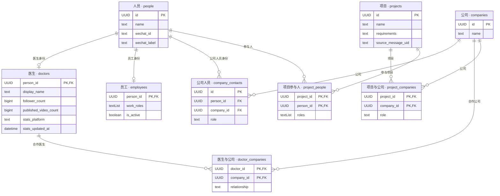
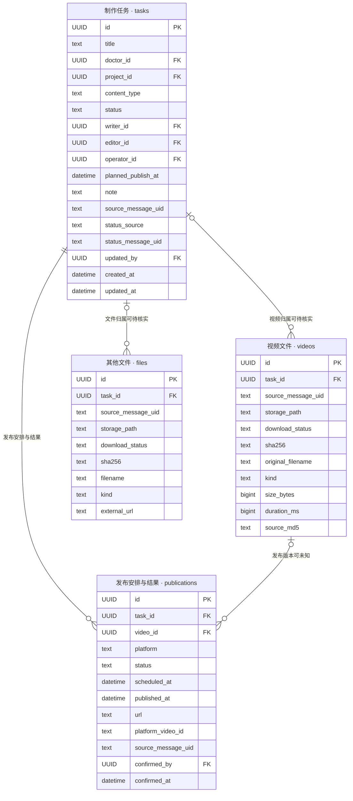
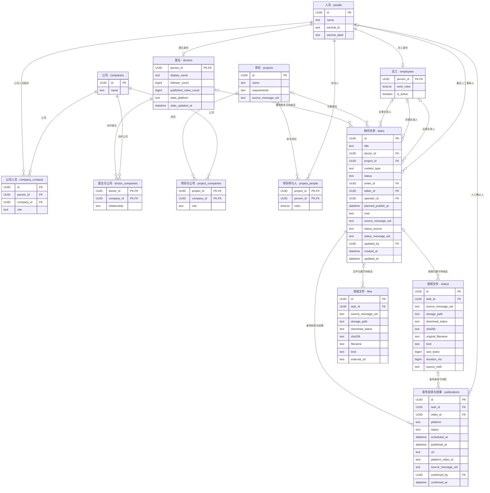

# 麦子工作台：task 核心数据库与字段目录

2026-10-17 v01｜设计稿。13张业务表，优先自动获取，人工保留纠正入口。

[网页与放大图](maizi-task-database-20261017-v01.html)

## 人员与合作关系

## 任务、视频、文件与发布

## 完整 ERD

## 人员 `people`

一个人的共同身份

| 字段 | 类型 | 必填 | 含义 | 来源 |
|---|---|---|---|---|
| id | UUID PK | 是 | 人员编号 | 系统生成 |
| name | text | 是 | 姓名或可识别称呼；未实名时可用原昵称 | 微信、已有人员资料 |
| wechat_id | text | 否 | 微信稳定账号标识；已知值唯一 | 微信消息发送者 |
| wechat_label | text | 否 | 微信昵称或备注 | 微信联系人资料 |

## 医生 `doctors`

people 中具有医生身份的人

| 字段 | 类型 | 必填 | 含义 | 来源 |
|---|---|---|---|---|
| person_id | UUID PK FK | 是 | 对应 people.id | 已知医生名单或明确身份依据 |
| display_name | text | 否 | 医生账号或对外展示名称 | 已有医生资料、群聊 |
| follower_count | bigint | 否 | 主要账号粉丝数；未知不填0 | 已有飞书或账号采集 |
| published_video_count | bigint | 否 | 该账号已发布视频数，不是本系统任务数 | 已有飞书或账号采集 |
| stats_platform | text | 否 | 这组数字所属平台；暂按一个主要账号 | 同一统计来源 |
| stats_updated_at | datetime | 否 | 统计对应的采集时间 | 同一统计来源 |

## 员工 `employees`

people 中的员工身份

| 字段 | 类型 | 必填 | 含义 | 来源 |
|---|---|---|---|---|
| person_id | UUID PK FK | 是 | 对应 people.id | 已有员工名单、明确身份依据 |
| work_roles | text[] | 否 | 文案、剪辑、运营等，可多个；不是每项任务的实际分工 | 已有员工资料、明确分工消息 |
| is_active | boolean | 否 | 是否仍参与工作；未知可空，不能因长期未发言推断离职 | 已有人员配置或明确确认 |

## 公司人员 `company_contacts`

一个人与一家公司之间的任职或对接身份

| 字段 | 类型 | 必填 | 含义 | 来源 |
|---|---|---|---|---|
| id | UUID PK | 是 | 记录编号 | 系统生成 |
| person_id | UUID FK | 是 | 对应 people.id | 人员匹配 |
| company_id | UUID FK | 是 | 对应 companies.id | 已有资料或明确公司归属 |
| role | text | 否 | 对接、审核等职责 | 明确介绍或分工 |

## 公司 `companies`

一家公司或合作机构

| 字段 | 类型 | 必填 | 含义 | 来源 |
|---|---|---|---|---|
| id | UUID PK | 是 | 公司编号 | 系统生成 |
| name | text | 是 | 公司名称 | 已有项目资料或明确消息 |

## 医生与公司 `doctor_companies`

一位医生与一家公司的实际合作关系

| 字段 | 类型 | 必填 | 含义 | 来源 |
|---|---|---|---|---|
| doctor_id | UUID PK FK | 是 | 对应 doctors.person_id | 已确认关系 |
| company_id | UUID PK FK | 是 | 对应 companies.id | 已确认关系 |
| relationship | text | 否 | 合作类型或简短说明；不能由项目参与自动推断 | 已有合作资料、明确消息 |

## 项目 `projects`

一个明确的合作项目

| 字段 | 类型 | 必填 | 含义 | 来源 |
|---|---|---|---|---|
| id | UUID PK | 是 | 项目编号 | 系统生成 |
| name | text | 是 | 项目名称 | 已有项目资料、明确消息 |
| requirements | text | 否 | 已经明确的合作要求；不要求员工补写 | 已有资料或明确消息提取 |
| source_message_uid | text | 否 | 相关要求的来源消息；非群聊来源可空 | 已有聊天库 |

## 项目与公司 `project_companies`

项目的客户或合作公司

| 字段 | 类型 | 必填 | 含义 | 来源 |
|---|---|---|---|---|
| project_id | UUID PK FK | 是 | 对应 projects.id | 已有项目关系 |
| company_id | UUID PK FK | 是 | 对应 companies.id | 已有项目关系 |
| role | text | 否 | 客户、执行方、合作方等 | 明确合作资料 |

## 项目参与人 `project_people`

一个人在某项目中承担的身份或分工

| 字段 | 类型 | 必填 | 含义 | 来源 |
|---|---|---|---|---|
| project_id | UUID PK FK | 是 | 对应 projects.id | 已知项目 |
| person_id | UUID PK FK | 是 | 对应 people.id | 已有分配或明确消息 |
| roles | text[] | 否 | 项目医生、文案、剪辑、运营、客户对接等 | 已有分工、明确消息 |

## 制作任务 `tasks`

一项从明确需求到发布的制作工作；本模型核心

| 字段 | 类型 | 必填 | 含义 | 来源 |
|---|---|---|---|---|
| id | UUID PK | 是 | 任务编号 | 系统生成 |
| title | text | 是 | 任务名称，可先用暂定标题 | 脚本标题或明确需求 |
| doctor_id | UUID FK | 否 | 对应 doctors.person_id；归属未确定时可空 | 已确认群关系、消息或既有资料 |
| project_id | UUID FK | 否 | 对应 projects.id；日常内容可无项目 | 既有关系或明确消息 |
| content_type | text | 是 | 科普、患教、其他、未知；不得凭猜测填患教 | 明确脚本或需求，默认未知 |
| status | text | 是 | 当前进度，可由明确证据推进或人工更正 | 规则识别或人工确认，默认待准备 |
| writer_id | UUID FK | 否 | 对应 employees.person_id；不是直接取发文件的人 | 明确分工；项目分工只作初始依据 |
| editor_id | UUID FK | 否 | 对应 employees.person_id | 明确分工或可靠上下文 |
| operator_id | UUID FK | 否 | 对应 employees.person_id | 明确运营或发布分工 |
| planned_publish_at | datetime | 否 | 计划发布时间，不等于实际发布 | 明确档期消息或已有排期 |
| note | text | 否 | 可选短说明：需求、修改意见或卡点；优先展示原话，不要求手填 | 明确消息提取或人工纠正 |
| source_message_uid | text | 否 | 建立任务的依据消息；导入任务可空 | 聊天库稳定 uid |
| status_source | text | 是 | 当前状态依据：自动识别、人工确认、导入；用于防止自动覆盖人工 | 系统记录 |
| status_message_uid | text | 否 | 支持当前状态的那条消息；人工无消息确认时可空 | 聊天库稳定 uid |
| updated_by | UUID FK | 否 | 对应 people.id；仅人工操作填操作人，自动处理留空 | 平台登录身份 |
| created_at | datetime | 是 | 任务创建时间 | 系统 |
| updated_at | datetime | 是 | 最近一次更新的时间，不是业务发生时间 | 系统 |

## 视频文件 `videos`

属于任务的一段原片或一份成片；没有视频之间的关联

| 字段 | 类型 | 必填 | 含义 | 来源 |
|---|---|---|---|---|
| id | UUID PK | 是 | 文件记录编号 | 系统生成 |
| task_id | UUID FK | 否 | 所属 tasks.id；不确定先留空 | 消息引用、标题和上下文匹配 |
| source_message_uid | text | 否 | 首次来源消息，用于查发送者、群、时间和上下文；导入无消息可空 | 聊天库稳定 uid |
| storage_path | text | 否 | 实际可用的本地或归档路径；未下载可空 | 下载归档程序 |
| download_status | text | 是 | 待下载、下载中、已下载、失败、文件缺失；链接资料可无需下载 | 下载程序 |
| sha256 | text | 否 | 下载后计算的文件内容哈希；未知留空 | 系统计算 |
| original_filename | text | 否 | 本地或微信实际提供的文件名，可能是哈希名，不当作选题 | 文件系统、微信元数据 |
| kind | text | 是 | 原片、成片、参考视频、未知；默认未知 | 文件上下文与发送内容 |
| size_bytes | bigint | 否 | 完整视频文件字节数 | 本地文件 |
| duration_ms | bigint | 否 | 视频时长，毫秒 | 媒体信息读取 |
| source_md5 | text | 否 | 微信消息提供的校验值，辅助与本地文件对应 | 微信媒体元数据 |

## 其他文件 `files`

脚本、大纲、封面等非视频文件；没有文件之间的关联

| 字段 | 类型 | 必填 | 含义 | 来源 |
|---|---|---|---|---|
| id | UUID PK | 是 | 文件记录编号 | 系统生成 |
| task_id | UUID FK | 否 | 所属 tasks.id；不确定先留空 | 消息引用、标题和上下文匹配 |
| source_message_uid | text | 否 | 首次来源消息，用于查发送者、群、时间和上下文；导入无消息可空 | 聊天库稳定 uid |
| storage_path | text | 否 | 实际可用的本地或归档路径；未下载可空 | 下载归档程序 |
| download_status | text | 是 | 待下载、下载中、已下载、失败、文件缺失；链接资料可无需下载 | 下载程序 |
| sha256 | text | 否 | 下载后计算的文件内容哈希；未知留空 | 系统计算 |
| filename | text | 否 | 真实附件名；纯链接没有名称时可空 | 微信附件或本地文件 |
| kind | text | 是 | 脚本、大纲、封面、发布文案、参考资料、其他、未知 | 文件名、格式及聊天上下文 |
| external_url | text | 否 | 腾讯文档、飞书等外部资料地址 | 消息中的文档链接 |

## 发布安排与结果 `publications`

任务在一个平台的一次发布；多平台和重发分别记录

| 字段 | 类型 | 必填 | 含义 | 来源 |
|---|---|---|---|---|
| id | UUID PK | 是 | 发布记录编号 | 系统生成 |
| task_id | UUID FK | 是 | 所属 tasks.id | 已确认任务 |
| video_id | UUID FK | 否 | 对应 videos.id；未能确定具体文件版本时可空 | 明确关联或人工确认 |
| platform | text | 是 | 发布平台 | 链接、明确消息或已有发布数据 |
| status | text | 是 | 待安排、已定时、已发布、已取消、已下架 | 明确操作结果、实际平台数据或人工确认 |
| scheduled_at | datetime | 否 | 实际设置的定时；“计划明天发”不算已设置定时 | 明确操作确认 |
| published_at | datetime | 否 | 实际发布时间；不是改表时间 | 实际发布数据或明确确认 |
| url | text | 否 | 实际发布链接；人工已确认发布时允许待补 | 聊天链接、已有采集 |
| platform_video_id | text | 否 | 平台上的视频编号，用于去重 | 发布链接或平台数据 |
| source_message_uid | text | 否 | 支持该安排或发布结果的消息 | 聊天库稳定 uid |
| confirmed_by | UUID FK | 否 | 对应 people.id；仅人工确认时填写 | 平台登录身份 |
| confirmed_at | datetime | 否 | 系统记下本次确认的时间 | 系统 |

## 更新规则

- 以 tasks 为核心；videos 与 files 各自只挂任务，没有上一版、下一版的自关联，也没有视频与其他文件之间的关系。publications 可指向明确的发布视频。
- 不同内容保存独立文件行；同任务内相同哈希可去重，保留首次来源消息。其他发送记录仍在现有聊天库中，不承诺由这一条来源字段直接枚举全部转发。不同任务可以分别引用同一个实际文件。
- 不设 owner、waiting_on_person、current_feedback、blocker、due_at；不设 reviews、todos、交付表、修改历史表。需求、修改意见等优先看原消息，必要时自动提取到 note。
- 不设版本号、是否当前版、是否终版等无法稳定自动获得的字段；同一任务下多个文件分别保存，界面可按来源消息时间排序，不能把最后收到的文件自动认定为终版。
- 字段“必填”表示落库要求，不是人工填表。人员分工和归属不明可留空；只有明确的一项工作才建任务，不把每条视频消息自动当新任务。
- 已有角色、公司、项目关系优先复用；发送人不等于作者或负责人，群名不独立证明公司合作关系，无法确认不自动补全。
- 状态建议集合：待准备、文案中、待审稿、录制中、待剪辑、剪辑中、待审片、待发布、已定时、已发布、暂停、异常、已取消、已下架。字段可扩展，但不强制逐步打卡。
- 明确对应任务、无冲突的消息可以按规则自动推进。下载完成本身不能说明素材收齐、可剪或审核通过；“可以发”不等于“已定时”或“已发布”。同一消息重复处理必须幂等。
- 当前状态为人工确认时，自动结果只提示，不覆盖；其他冲突或旧消息同样先核对。员工仍可直接修改、跳步或退回。status_source 与 status_message_uid 用于保留当前依据，不是修改历史。
- 更新使用 updated_at 或等价条件检查避免并发覆盖。updated_by 自动修改时留空，不能把聊天发送者伪装成平台操作人。既有状态被更新后不承诺能恢复历次变更。
- 人员发送时间、群和发言人通过 source_message_uid 查聊天库，不重复填。系统创建／更新的技术时间不代替发送或发布时间；非聊天来源允许该字段为空。
- 粉丝数、账号视频数从同一个已确认主要账号的数据源同步，连同平台和采集时间一起更新；未知留空，不填零，也不混合多个账号。账号详情沿用已有资料，暂不新建账号表。
- 发布多平台各建记录，重发另建；video_id 若非空必须属于同一 task。人工已确认发布但缺链接时保留已发布，界面根据空值显示待补。一个平台发布成功不自动代表任务所有平台完成。
- 微信目录只作收件入口，文件归档成功后更新 storage_path；删除缓存不退回业务状态。计算哈希前等待写入稳定，媒体完整性检查不等于业务素材可用。
- 本版仅为设计文档，尚未修改业务数据库或下载服务。原微信聊天库继续复用，不属于这13张业务表；跨库消息引用由应用校验。